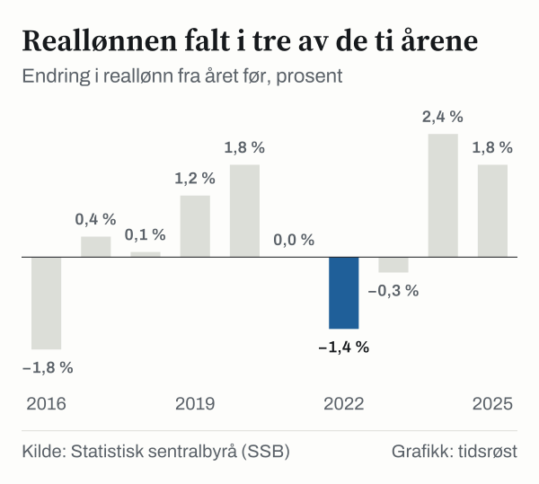

4,3 prosent. Så mye høyere var reallønnen til en gjennomsnittlig lønnstaker i Norge i 2025 enn i 2015, når lønnen regnes om til samme prisnivå. I kroner ser tiåret helt annerledes ut. Årslønnen var 519 800 kroner i 2015. I 2025 var den 746 700 kroner, en økning på 43,7 prosent. Prisene steg 37,7 prosent i samme periode, og det er forskjellen mellom de to tallene som avgjør hva lønnen faktisk rekker til.

For en lønnstaker med gjennomsnittlig lønn tilsvarer 4,3 prosent 30 722 kroner mer i året enn lønnen i 2015 ville ha gitt, regnet i prisnivået i 2025. Det er en reell forbedring, regnet over ti år.

Bildet blir ikke enklere når Norge settes ved siden av andre land. OECDs egne tall viser en reell lønnsvekst for Norge på 9,4 prosent over det samme tiåret, nesten likt med OECD samlet. SSB og OECD gir altså to svar. Denne analysen viser hvor forskjellen oppstår, og hva begge sier om hva lønnen rekker til.

## Fra lønnsslipp til realverdi

Statistisk sentralbyrå (SSB) måler gjennomsnittlig årslønn for lønnstakere i nasjonalregnskapet. I 2015 var tallet 519 800 kroner. I 2020 var det 593 500 kroner, i 2022 var det 640 700 kroner, og i 2025 var det 746 700 kroner. Lønnen i kroner var høyere enn året før i hvert eneste år i perioden 2016–2025.

Veksten var svakest i 2016 og sterkest i 2024. Lønnen steg med 1,7 prosent i 2016, med 4,3 prosent i 2022, med 5,2 prosent i 2023, med 5,6 prosent i 2024 og med 4,9 prosent i 2025. Over hele tiåret ble lønnen 43,7 prosent høyere. Et slikt tall forteller hva som står på lønnsslippen, men ikke hva lønnen rekker til. For det trengs et mål på prisene.

SSB beregner konsumprisindeksen (KPI), som følger prisene på varer og tjenester som husholdningene betaler for. Indeksen har basisår i 2025. Den lå på 72,6 i 2015, på 89,2 i 2022 og på 94,1 i 2023. Prisene steg dermed 37,7 prosent i perioden 2015–2025.

Regnestykket vårt er enkelt. Vi tar lønnen i hvert år og regner den om til prisnivået i 2025, med forholdet mellom KPI i 2025 og KPI i det aktuelle året. I 2015 var lønnen 519 800 kroner, og den tilsvarer da 715 978 kroner i prisnivået i 2025. I 2025 var lønnen 746 700 kroner. Forskjellen er 30 722 kroner, eller 4,3 prosent. Det er tiårets reallønnsvekst, og den tilsvarer om lag 0,4 prosent i året.

*Gjennomsnittlig årslønn i kroner; reell lønn er regnet om til prisnivået i det siste året. Kilde: Statistisk sentralbyrå (SSB).*

## Reallønnen år for år

Utviklingen kom ikke jevnt. Den reelle lønnen var 715 978 kroner i 2015. I 2019 var den 716 045 kroner, nesten uendret på fire år. I 2021 hadde den steget til 728 707 kroner. I 2023 hadde den falt tilbake til 716 259 kroner, og i 2025 var den 746 700 kroner.

Reallønnen i 2023 lå dermed bare 0,04 prosent over nivået i 2015. Lønnstakerne hadde i praksis samme reelle lønn som åtte år tidligere, selv om lønnen i kroner var 29,7 prosent høyere. I årene 2023–2025 steg reallønnen 4,2 prosent, nesten like mye som i hele tiåret samlet.

SSB publiserer også en egen serie for endringen i reallønn fra år til år. Endringen var −1,8 prosent i 2016, −1,4 prosent i 2022 og −0,3 prosent i 2023. I 2021 var endringen null. Størst var økningen i 2024, med 2,4 prosent.

To av de tre årene med fall kom samtidig med sterk lønnsvekst i kroner. Lønnen steg med 4,3 prosent i 2022, men reallønnen endret seg med −1,4 prosent. Lønnen steg med 5,2 prosent i 2023, men reallønnen endret seg med −0,3 prosent. Prisene steg altså raskere enn lønnen begge årene.

*Endring i reallønn fra året før, prosent. Kilde: Statistisk sentralbyrå (SSB).*

## Norge ved siden av OECD og naboene

OECD publiserer gjennomsnittlig årslønn per heltidsekvivalent, regnet om til amerikanske dollar justert for prisnivået i hvert land (PPP) og til faste priser med basisår i 2025. PPP betyr at valutaene er omregnet slik at en dollar skal rekke omtrent like langt i alle landene.

I OECDs serie lå gjennomsnittslønnen i Norge på 67 127 dollar i 2015 og på 73 462 dollar i 2025. Det er en økning på 9,4 prosent. For OECD samlet steg tallet fra 59 422 dollar til 64 803 dollar, en økning på 9,1 prosent. Norge vokste dermed omtrent like mye som gjennomsnittet.

Nivåforskjellen er også nesten uendret. Norge lå 1,13 ganger OECD-nivået i 2015. I 2025 lå det 1,13 ganger over. I dollar var avstanden til OECD-snittet 7 706 dollar i 2015. I 2025 var den 8 659 dollar. Siden 2021 har Norge vokst litt raskere enn OECD samlet, med 2,5 prosent mot 1,6 prosent.

Tar vi med noen av landene Norge vanligvis sammenlignes med, blir spredningen tydelig. Sverige hadde en reell vekst på 3,2 prosent i perioden 2015–2025, Finland 3,8 prosent og Storbritannia 3,3 prosent. Danmark hadde 6,9 prosent og Tyskland 7,1 prosent. USA skiller seg ut med 13,0 prosent.

Siden 2021 er bildet et annet. Reallønnen i Sverige falt med 3,9 prosent. I Finland falt den med 3,3 prosent, og i Storbritannia falt den med 0,3 prosent. Danmark kom ut med 0,9 prosent, USA med 0,3 prosent og Tyskland med 2,2 prosent. Norge hadde 2,5 prosent, den høyeste veksten av de sju landene i denne perioden.

Danmark har fortsatt høyere lønnsnivå enn Norge i OECDs serie. Avstanden har likevel blitt mindre. Norges lønn lå 5 898 dollar under den danske i 2015. I 2025 lå den 4 629 dollar under.

*Gjennomsnittlig årslønn i faste priser, amerikanske dollar justert for prisnivået (PPP). Kilde: OECD.*

Når lønnen regnes i hvert lands egen valuta og i løpende priser, er veksten stor overalt. Norge hadde en økning på 42,6 prosent i perioden 2015–2025, Sverige 37,1 prosent, Danmark 29,4 prosent og Finland 25,2 prosent. Tyskland hadde 40,3 prosent, Storbritannia 40,4 prosent og USA 47,3 prosent.

Avstanden mellom nominell og reell vekst skyldes prisutviklingen i omregningen. I Norge ble 42,6 prosent nominelt til 9,4 prosent reelt. I Sverige ble 37,1 prosent til 3,2 prosent, og i Storbritannia ble 40,4 prosent til 3,3 prosent. Danmark hadde lavere nominell vekst, med 29,4 prosent, men endte på 6,9 prosent reelt. I alle de sju landene ble den reelle veksten mindre enn halvparten av den nominelle.

*Vekst i gjennomsnittlig årslønn, prosent; nominell i nasjonal valuta, reell i faste priser. Kilde: OECD.*

## To mål på reallønn gir to svar

SSBs tall gir en reell vekst på 4,3 prosent for Norge, OECDs tall gir 9,4 prosent. Den nominelle veksten er nesten lik: 43,7 prosent hos SSB og 42,6 prosent hos OECD. Avstanden mellom de to svarene ligger altså i hvordan lønnen regnes om til faste priser.

OECDs serie for Norge var 515 246 kroner i 2015 i løpende priser. Regnet om til faste priser med basisår i 2025 er den samme lønnen 671 363 kroner, en oppjustering på 30,3 prosent. Konsumprisindeksen som vi brukte, steg 37,7 prosent. Vi har ikke undersøkt hvilken prisindeks som ligger bak OECDs omregning, og kan derfor ikke si hvorfor de to prisutviklingene er ulike.

Avviket stammer fra årene 2015–2021. I den perioden gir OECDs tall en reell vekst på 6,8 prosent, mens SSBs tall gir 1,8 prosent. Siden 2021 har begge gitt 2,5 prosent. Siden 2021 er de to seriene altså enige om utviklingen.

## Startåret avgjør svaret

Det samme datamaterialet kan leses på flere måter, og startåret betyr mye. Regnet siden 2015 steg reallønnen 4,3 prosent. Regnet siden 2021 steg den 2,5 prosent. Regnet siden 2023 steg den 4,2 prosent, på to år.

Regnestykkene svarer på ulike spørsmål, og alle tre er riktige.

Tallet på 4,3 prosent over ti år skjuler to ulike faser. Reallønnen i 2019 var på samme nivå som i 2015, og det samme gjaldt i 2023. I SSBs egen serie kom økningene i 2020, med 1,8 prosent, og i 2024, med 2,4 prosent. I 2025 var økningen 1,8 prosent.

## Det gjennomsnittet ikke sier

Tallene i denne analysen er gjennomsnitt. De sier hva en gjennomsnittlig lønnstaker tjente, ikke hva en bestemt lønnstaker tjente. Noen grupper kan ha hatt en sterkere eller svakere utvikling enn gjennomsnittet, og tallene viser ikke fordelingen.

Det som er målt her, er lønn før skatt og fradrag. Hva husholdningene sitter igjen med etter skatt og faste utgifter, inngår ikke. Konsumprisindeksen følger en gjennomsnittlig kurv av varer og tjenester. En husholdning med et annet forbruk enn gjennomsnittet har opplevd en annen prisutvikling enn indeksen viser.

Sammenligningen med andre land gjelder nivåer og vekst i faste dollar justert for prisnivået (PPP). Den forteller ikke hva en lønnstaker i Norge får ut av lønnen i Norge. Både SSB og OECD kan også revidere tidligere tall når nasjonalregnskapene oppdateres, og tallene for det siste året er de mest utsatte. Tallene gjelder til og med året 2025.

## Slik regnet vi

Vi har brukt SSBs tabell om årslønn påløpt og SSBs tabell om konsumprisindeksen, begge for årene 2015–2025. Reell lønn for hvert år er lønnen i kroner, regnet om til prisnivået i 2025 med forholdet mellom konsumprisindeksen i 2025 og i det aktuelle året. Vekst er endringen i prosent mellom to år. Som eksempel var lønnen 640 700 kroner i 2022, og KPI var 89,2. Det gir 718 274 kroner i prisnivået i 2025. Samme beregning er gjort for hvert år, slik at hele serien står i samme prisnivå og kan sammenlignes direkte.

For den internasjonale sammenligningen har vi brukt OECDs datasett om gjennomsnittlig årslønn, i faste priser og amerikanske dollar justert for prisnivået (PPP), og samme datasett i nasjonal valuta og løpende priser. Vi har selv regnet vekst i perioden 2015–2025 og siden 2021, med utgangspunkt i de oppgitte årsverdiene. Alle tall er hentet 23. oktober 2026.

## Kilder

- [SSB: Årslønn påløpt](https://www.ssb.no/statbank/table/14858)
- [SSB: Konsumprisindeks, historisk serie](https://www.ssb.no/statbank/table/14711)
- [OECD: Average annual wages, datasettbeskrivelse](https://sdmx.oecd.org/public/rest/dataflow/OECD.ELS.SAE/DSD_EARNINGS@AV_AN_WAGE/1.0)
