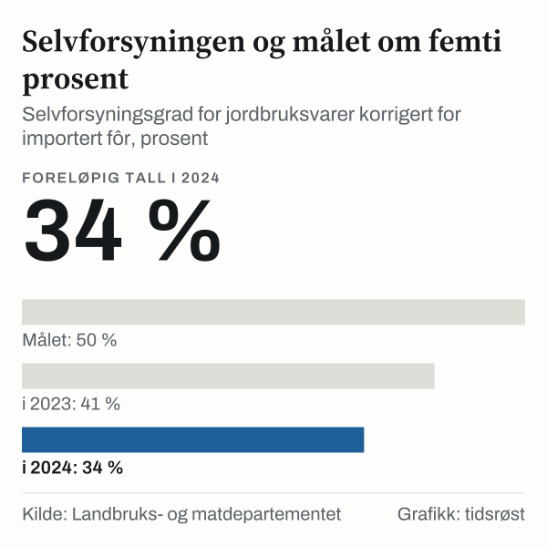

I 2025 var det 36 439 jordbruksbedrifter i Norge, viser foreløpige tall fra Statistisk sentralbyrå (SSB). De drev til sammen 9 839 227 dekar jordbruksareal. Landbruks- og matdepartementet oppgir om lag 36 600 jordbruksbedrifter i landbruksproposisjonen. I 1999 var det 70 740 bruk, og i 1969 154 977. Antallet bruk har gått ned med 13,3 prosent siden 2015, mens gjennomsnittsbruket har vokst fra 235 til 270 dekar.

## Fra 1969 til i dag

Antallet jordbruksbedrifter har gått ned i hvert tiår siden 1969: fra 154 977 i 1969 til 125 302 i 1979, 99 382 i 1989 og 70 740 i 1999. Siden 1999 er antallet nesten halvert.

*Jordbruksbedrifter i Norge, 1999–2025. Tallet for 2025 er foreløpig. Kilde: SSB, tabell 03313.*

## Færre mellomstore, flere store bruk

Nedgangen har vært størst blant de mellomstore brukene. I 2005 hadde 16 764 bruk mellom 100 og 200 dekar jordbruksareal, i 2025 8 496. Samtidig ble antallet bruk med 500 dekar eller mer doblet, fra 2 684 til 5 479.

*Jordbruksbedrifter etter jordbruksareal i drift, 2005 og 2025. Kilde: SSB, tabell 03313.*

Ifølge landbruksproposisjonen Prop. 98 S (2025–2026) fra Landbruks- og matdepartementet hadde den landbruksbaserte delen av næringsmiddelindustrien om lag 39 000 sysselsatte, og verdiskapingen var 53 milliarder kroner i 2024.

## Selvforsyningen og målet

Selvforsyningsgraden uttrykker hvor stor del av kostholdet som kan dekkes av norsk jordbruk. Regjeringen har som mål å øke selvforsyningsgraden for jordbruksvarer til 50 prosent, korrigert for import av fôrråvarer. Målet ble behandlet i Meld. St. 11 (2023–2024) *Strategi for auka sjølvforsyning av jordbruksvarer og plan for opptrapping av inntektsmoglegheitene i jordbruket*.

Ifølge Prop. 98 S var den fôrkorrigerte selvforsyningsgraden 40 prosent i 2021 og 2022, 41 prosent i 2023 og foreløpig 34 prosent i 2024. Tallene for 2024 er ifølge proposisjonen foreløpige og sterkt påvirket av svært dårlige kornavlinger i 2023. Andelen norskprodusert råvare i kraftfôr var 60 prosent i 2025, mot 49 prosent i 2024, og 85 prosent av fôret til husdyrene var produsert i Norge i 2025.

*Selvforsyningsgrad korrigert for importert fôr, og målet på 50 prosent. Tallet for 2024 er foreløpig. Kilde: Landbruks- og matdepartementet, Prop. 98 S (2025–2026).*

## Beredskapslager for matkorn

Staten bygger opp et beredskapslager av mathvete. Ifølge regjeringen skal lageret tilsvare om lag tre måneders normalt forbruk, det vil si 82 500 tonn. Oppbyggingen skjer i trinn, med 15 000 tonn hvert år fra 2024 til 2028 og 7 500 tonn i 2029. Staten eier kornet, mens kornaktørene lagrer det på kontrakt. I juni 2024 inngikk staten avtaler om 30 000 tonn med fire aktører i kornbransjen.

## Salg av antibiotika til landdyr

Salget av antibiotika til landdyr i Norge var i 2025 på det laveste nivået siden rapporteringen startet i 1993, ifølge regjeringen. Forekomsten av antibiotikaresistens hos dyr og i mat er fortsatt lav, og Folkehelseinstituttet knytter det til lavt forbruk av antibiotika.

## Kilder

- [Landbruks- og matdepartementet: Prop. 98 S (2025–2026) Endringer i statsbudsjettet 2026 under Landbruks- og matdepartementet (Jordbruksoppgjøret 2026)](https://www.regjeringen.no/no/dokumenter/prop.-98-s-20252026/id3162996/?ch=3)
- [Stortinget: Innst. 258 S (2023–2024) om Meld. St. 11 (2023–2024)](https://stortinget.no/no/Saker-og-publikasjoner/Publikasjoner/Innstillinger/Stortinget/2023-2024/inns-202324-258s/?m=1)
- [SSB Statistikkbanken: Tabell 03313 – Jordbruksbedrifter, etter jordbruksareal i drift](https://www.ssb.no/statbank/table/03313)
- [SSB Statistikkbanken: Tabell 12659 – Jordbruksbedrifter og jordbruksareal, etter driftsform](https://www.ssb.no/statbank/table/12659)
- [Landbruks- og matdepartementet: Høringsnotat om endringer i fôr- og tollkvoteforskriften (beredskapslager for matkorn)](https://www.regjeringen.no/contentassets/d618d09bfb814bb28a8e289d4ce346d6/horingsnotat-endringer-i-fat-og-tollkvoteforsk1247675.pdf)
- [Regjeringen: Nye kontraktar for beredskapslagring av matkorn](https://www.regjeringen.no/no/aktuelt/nye-kontraktar-for-beredskapslagring-av-matkorn/id3061307/)
- [Folkehelseinstituttet: NORM og NORM-VET 2025](https://www.fhi.no/publ/2026/norm-og-norm-vet-2025-usage-of-antimicrobial-agents-and-occurrence-of-antimicrobial-resistance-in-norway/)
- [Regjeringen: Forekomst av antibiotikaresistens hos dyr og i mat i Norge](https://www.regjeringen.no/no/aktuelt/fortsatt-rekordlav-forekomst-av-antibiotikaresistens-hos-dyr-og-i-mat-i-norge/id3173217/)
