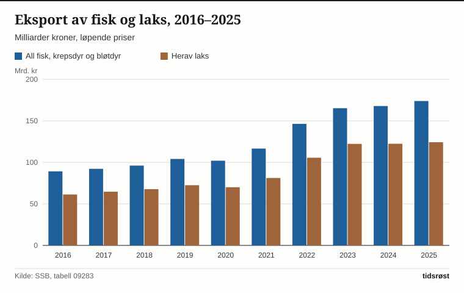

I 2025 eksporterte Norge 2,3 millioner tonn fisk, krepsdyr og bløtdyr til en samlet verdi av 173,9 milliarder kroner, viser tall fra Statistisk sentralbyrå (SSB). Beløpet er 6,0 milliarder kroner – eller 3,6 prosent – høyere enn i 2024 og det høyeste i SSBs statistikkbank, som går tilbake til 2007.

Alene sto laks for 124,3 milliarder kroner. Gjennom de åtte første månedene av 2026 var eksportverdien for fisk, krepsdyr og bløtdyr 110,4 milliarder kroner, en økning på 2,0 prosent fra samme periode året før.

## Større laksevolum, men lavere kilopris

Norge eksporterte 1,41 millioner tonn laks i 2025, ifølge SSB. Mens volumet økte med 12,8 prosent fra 2024, vokste eksportverdien med bare 1,5 prosent, til 124,3 milliarder kroner. Forskjellen mellom volumvekst og verdivekst betyr at gjennomsnittsverdien per kilo falt: fra om lag 98 kroner i 2024 til om lag 88 kroner i 2025, regnet ut fra SSBs verdi- og mengdetall.

Med 124,3 av 173,9 milliarder kroner utgjorde laksen 71,5 prosent av eksportverdien for fisk, krepsdyr og bløtdyr i 2025. Bak laksen fulgte torsk med 12,7 milliarder kroner, makrell med 8,1 milliarder og ørret med 7,4 milliarder kroner.

*Eksportverdien av fisk nesten doblet seg fra 2016 til 2025. Kilde: SSB, tabell 09283.*

## Polen største marked, Kina vokste raskest

Polen var det største enkeltmarkedet for norsk fisk, krepsdyr og bløtdyr i 2025. Eksporten til Kina vokste raskest blant de største markedene, mens den til Danmark gikk markant tilbake:

| Marked | 2025 (mrd. kr) | Endring fra 2024 |
|---|---|---|
| Polen | 19,0 | +5,5 % |
| USA | 15,2 | +19,5 % |
| Kina | 12,3 | +32,0 % |
| Nederland | 10,6 | −2,7 % |
| Frankrike | 10,6 | −0,1 % |
| Danmark | 10,2 | −21,4 % |

*Eksport av fisk, krepsdyr og bløtdyr etter mottaksland. Kilde: SSB, tabell 09283.*

## Nesten tre ganger større enn aluminiumseksporten

Når råolje, naturgass, kondensat, skip og oljeplattformer holdes utenfor, sto Norge igjen med en fastlandseksport på 768,1 milliarder kroner i 2025. Med 173,9 milliarder kroner i SSBs statistikk sto fisk, krepsdyr og bløtdyr for 22,6 prosent av hele den norske fastlandseksporten.

Bryter man statistikken ned på enkeltvaregrupper, blir sjømatens særstilling enda tydeligere: Varegruppen fersk, kjølt eller fryst fisk alene utgjorde 156,7 milliarder kroner i 2025. Det er nesten tre ganger så mye som eksporten av både aluminium (52,9 milliarder kroner) og raffinerte oljeprodukter (51,8 milliarder kroner). Laks alene (124,3 milliarder kroner) er om lag 2,3 ganger større enn aluminiumseksporten.

*Fersk og fryst fisk er den klart største varegruppen utenom olje og gass. Kilde: SSB, tabell 08818.*

Gjennom perioden januar–august 2026 bokførte SSB en fiskeeksport på 110,4 milliarder kroner, en økning på 2,0 prosent fra samme periode i 2025. Det tilsvarer 21,1 prosent av den samlede fastlandseksporten på 523,8 milliarder kroner i åttemånedersperioden.

## Uendret grunnrenteskatt i 2027-budsjettet

Oppdrettsnæringen er underlagt grunnrenteskatt på havbruk. I Finansdepartementets oversikt over skattesatser, lagt fram 7. oktober 2026, videreføres den formelle satsen på 32,1 prosent fra 2026 til 2027. Ettersom grunnrenterelatert selskapsskatt trekkes fra i skattegrunnlaget, tilsvarer dette en effektiv grunnrenteskatt på 25 prosent, med et bunnfradrag på 70 millioner kroner per konsern.

## Kilder

- [SSB Statistikkbanken, tabell 09283: Eksport av fisk, etter varegruppe og land](https://www.ssb.no/statbank/table/09283/)
- [SSB Statistikkbanken, tabell 08818: Utenrikshandel med varer, etter varegruppe](https://www.ssb.no/statbank/table/08818/)
- [SSB Statistikkbanken, tabell 08804: Utenrikshandel med varer, hovedtall, årstall](https://www.ssb.no/statbank/table/08804/)
- [SSB Statistikkbanken, tabell 08803: Utenrikshandel med varer, hovedtall, måned](https://www.ssb.no/statbank/table/08803/)
- [SSB: Utenrikshandel med varer](https://www.ssb.no/utenriksokonomi/utenrikshandel/statistikk/utenrikshandel-med-varer)
- [Regjeringen.no: Skattesatser 2027](https://www.regjeringen.no/no/tema/okonomi-og-budsjett/skatter-og-avgifter/skatte-og-avgiftssatser/skattesatser-2027/id3173438/)
