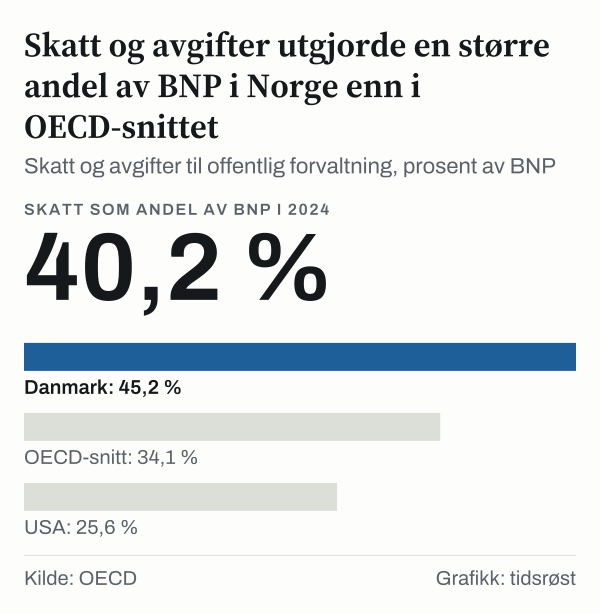
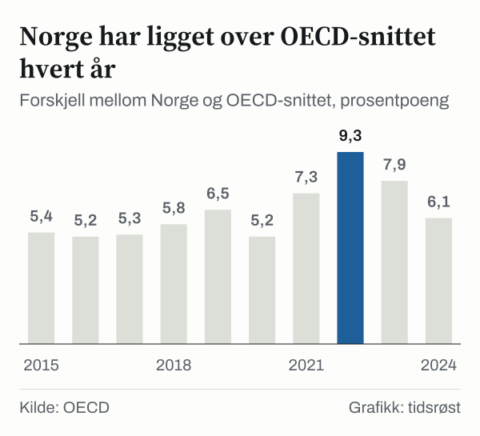

Har Norge verdens høyeste skattenivå? I OECDs tall er svaret nei. I 2024 utgjorde skatter og avgifter til staten, kommunene og trygdeordningene 40,2 prosent av bruttonasjonalproduktet (BNP) i Norge. Det er mer enn OECD-snittet på 34,1 prosent. Men Danmark lå på 45,2 prosent, og sju land til lå også over Norge: Frankrike, Østerrike, Italia, Belgia, Finland, Luxembourg og Sverige.

For den som vil vite hvor stor del av landets verdiskaping som går til det offentlige, er dette forholdstallet det vanligste målet. Det er også det som ligger bak de fleste rangeringer. Norge ligger over snittet, men ikke øverst. I perioden 2015–2024 var Norge ikke øverst i noe enkelt år.

Tallet for Norge svinger mer enn OECD-snittet, og forholdstallet har en nevner, BNP, som i Norge omfatter oljevirksomhet og utenriks sjøfart. Vi går gjennom ledetrådene en for en: hva tallet måler, hvor Norge ligger, hvordan det har endret seg, og hva som kan og ikke kan leses ut av det.

## Ledetråd én: hva tallet faktisk måler

OECD samler skatteinntektene for alle medlemslandene i Revenue Statistics. Tallene omfatter alle skatter og avgifter som går til offentlig forvaltning: stat, kommuner og trygdeordninger. Trygdeavgifter er en egen kategori i OECDs tabell og regnes med i totalen. Summen deles på landets BNP, slik at tallet blir en andel. Alle land følger samme inndeling, og det gjør tallene egnet til å sammenligne land med hverandre. De sier derimot lite om hvordan de enkelte skattene er utformet, og hvilke satser som gjelder.

Tallet sier altså hvor stor del av landets BNP som kommer inn til det offentlige i form av skatter og avgifter. Det sier ikke hvem som betaler, og det sier ikke hva pengene brukes til. For Norge utgjorde skatteinntektene 2 088,5 milliarder kroner i 2024.

Et slikt forholdstall er ikke en skattesats, og det er ikke andelen av en lønn som går til skatt. Det er en brøk mellom to store størrelser, og begge kan bevege seg uavhengig av hverandre.

*Skatt og avgifter til offentlig forvaltning, prosent av BNP. Kilde: OECD.*

## Ledetråd to: rangeringen i 2024

Danmark hadde det høyeste forholdstallet i 2024, med 45,2 prosent. Deretter fulgte Frankrike med 43,5 prosent, Østerrike med 43,4 prosent, Italia med 42,8 prosent, Belgia med 42,6 prosent og Finland med 42,2 prosent. Luxembourg lå på 41,5 prosent og Sverige på 41,4 prosent. Så kom Norge med 40,2 prosent.

Alle de tre nordiske naboene lå over Norge i 2024: Danmark med 45,2 prosent, Finland med 42,2 prosent og Sverige med 41,4 prosent. Norge kommer dermed på niende plass blant landene som har tall for året 2024. Under Norge ligger blant andre Hellas med 39,8 prosent, Nederland med 38,5 prosent og Tyskland med 38,0 prosent. USA lå på 25,6 prosent. Japan og Australia mangler tall for året 2024 i OECDs tabell, men begge lå under Norge i 2023, med 33,7 prosent og 29,9 prosent. Norge hadde 41,6 prosent det året.

OECD-snittet på 34,1 prosent er gjennomsnittet for medlemslandene i tabellen. Avstanden til Danmark er 5,0 prosentpoeng, og avstanden til OECD-snittet er 6,1 prosentpoeng. Norge ligger dermed i den øvre delen av feltet, men ikke på toppen.

*Skatt og avgifter til offentlig forvaltning, prosent av BNP. Kilde: OECD.*

## Ledetråd tre: Norge over tid, og hvem som økte

Ser vi på hvert år i perioden 2015–2024, var Danmark over Norge i ni av ti år. Det eneste unntaket var i 2022, da Danmark lå på 42,1 prosent og Norge på 43,3 prosent. Det året var Norge likevel ikke øverst. Frankrike hadde 45,9 prosent og Finland 43,4 prosent, så Norge var tredje høyeste land i OECDs tabell.

Utgangspunktet i 2015 var at Danmark lå på 46,5 prosent, Frankrike på 45,4 prosent, Finland på 43,8 prosent og Sverige på 42,9 prosent. Norge lå på 38,3 prosent. Tallet for Norge var 38,3 prosent i 2015 og 40,2 prosent i 2024, en økning på 1,9 prosentpoeng. Underveis gikk det opp og ned. I perioden 2015–2022 økte det med 5,0 prosentpoeng. I perioden 2022–2024 falt det med 3,1 prosentpoeng. OECD-snittet beveget seg mye mindre, fra 32,9 prosent i 2015 til 34,1 prosent i 2024, en økning på 1,1 prosentpoeng.

Forskjellen mellom Norge og OECD-snittet var dermed ikke stabil. Den var 5,4 prosentpoeng i 2015. I 2022 var den 9,3 prosentpoeng, og i 2024 var den 6,1 prosentpoeng. Danmark svingte også. Tallet falt med 5,4 prosentpoeng i perioden 2021–2022 og steg med 3,1 prosentpoeng i perioden 2022–2024.

![Linjediagram over Skattenivået i Norge svingte mer enn OECD-snittet: Norge: 38,3 % i 2015, 38,8 % i 2016, 38,6 % i 2017, 39,3 % i 2018, 39,9 % i 2019, 38,7 % i 2020, 41,3 % i 2021, 43,3 % i 2022, 41,6 % i 2023, 40,2 % i 2024; Danmark: 46,5 % i 2015, 45,8 % i 2016, 45,5 % i 2017, 44,4 % i 2018, 47,1 % i 2019, 47,2 % i 2020, 47,5 % i 2021, 42,1 % i 2022, 44,0 % i 2023, 45,2 % i 2024; OECD-snitt: 32,9 % i 2015, 33,6 % i 2016, 33,3 % i 2017, 33,4 % i 2018, 33,3 % i 2019, 33,5 % i 2020, 34,0 % i 2021, 34,0 % i 2022, 33,7 % i 2023, 34,1 % i 2024.](./graf-4.svg)
*Skatt og avgifter til offentlig forvaltning, prosent av BNP. Kilde: OECD.*

*Forskjell mellom Norge og OECD-snittet, prosentpoeng. Kilde: OECD.*

I perioden 2015–2024 økte forholdstallet med 1,9 prosentpoeng i Norge, med 0,7 prosentpoeng i Tyskland og med 2,4 prosentpoeng i Storbritannia. I de fem andre landene gikk det ned. Det falt med 1,3 prosentpoeng i Danmark. Det falt med 1,5 prosentpoeng i Sverige og med 1,6 prosentpoeng i Finland. Det falt med 1,9 prosentpoeng i Frankrike og med 0,5 prosentpoeng i USA.

Frankrike, som hadde 45,4 prosent i 2015, endte på 43,5 prosent. Sverige gikk fra 42,9 prosent til 41,4 prosent. Norge gikk fra 38,3 prosent til 40,2 prosent, og forskjellen til Sverige er dermed blitt mindre. Tyskland og Storbritannia lå begge under Norge i 2015, og økte også.

*Skatt og avgifter til offentlig forvaltning, prosent av BNP. Kilde: OECD.*

## Ledetråd fire: nevneren

Når et forholdstall svinger, kan det være telleren eller nevneren som beveger seg. Her er telleren skatteinntektene og nevneren BNP. Totaltallet fra OECD kan ikke si hvilken av dem som drev svingningene i Norge.

Én ting kan vi si om nevneren. Statistisk sentralbyrå (SSB) skiller mellom BNP og Fastlands-BNP. Fastlands-BNP holder oljevirksomhet og utenriks sjøfart utenfor. I 2024 var BNP 5 382,4 milliarder kroner og Fastlands-BNP 4 191,8 milliarder kroner, så BNP var 1,28 ganger så stort. Forskjellen på 1 190,6 milliarder kroner er verdien av oljevirksomheten og utenriks sjøfart.

Skatteinntektene på 2 088,5 milliarder kroner utgjør 49,8 prosent av Fastlands-BNP. Det er vår egen regning, og tallet kan ikke settes ved siden av andre lands forholdstall, som er regnet mot hele BNP. Regnestykket viser først og fremst at hvilken nevner man bruker, flytter tallet mye.

## Samme tall, ulik sammensetning

To land med nesten lik andel kan ha helt ulike skattesystemer. I 2024 fikk Norge inn 19,8 prosent av BNP som skatt på inntekt og overskudd, 9,4 prosent som trygdeavgifter og 9,8 prosent som skatt på varer og tjenester. Danmark fikk inn 30,9 prosent som skatt på inntekt og bare 0,1 prosent som trygdeavgifter. Sverige fikk inn 15,1 prosent som skatt på inntekt, 9,0 prosent som trygdeavgifter og 5,3 prosent som lønnsskatter.

| Land | Inntekt og overskudd | Trygdeavgifter | Lønnsskatter | Eiendom | Varer og tjenester |
|---|---|---|---|---|---|
| Norge | 19,8 % | 9,4 % | 0,1 % | 1,2 % | 9,8 % |
| Danmark | 30,9 % | 0,1 % | 0,3 % | 1,4 % | 12,3 % |
| Sverige | 15,1 % | 9,0 % | 5,3 % | 0,8 % | 11,2 % |

*Prosent av BNP i 2024. Kilde: OECD.*

Regnet i prosentpoeng henter Danmark 11,1 prosentpoeng mer av BNP fra skatt på inntekt enn Norge, men 9,4 prosentpoeng mindre fra trygdeavgifter. Sverige henter 5,2 prosentpoeng mer enn Norge fra lønnsskatter. Slike forskjeller betyr at samme totaltall kan skjule ulike måter å finansiere det offentlige på, og at en rangering etter totaltallet ikke sier noe om hvem som betaler.

## En annen måte å lese tallene på

Andel av BNP er ikke det eneste målet på skattenivå. Man kan også se på skatt per innbygger, på hva som tas av en lønnsinntekt av en gitt størrelse, eller på hvor stor del av husholdningenes inntekt som går til skatt. Også hvilket år man ser på, påvirker bildet. Norge var tredje høyeste land i 2022, men kom på niende plass i 2024, så en rangering for ett enkelt år kan gi et annet bilde enn utviklingen over flere år. Dette notatet har bare brukt OECDs mål, andel av BNP, fordi det er det målet OECD bruker i sine sammenligninger.

Et forholdstall på 40,2 prosent betyr heller ikke at 40,2 prosent av en lønn går til skatt. Telleren omfatter også skatt fra selskaper og skatt på forbruk, ikke bare skatt på lønn. Tallene her svarer bare på ett mål.

## Hva tallene ikke avgjør

Tallene gjelder OECDs medlemsland og sier ikke noe om land utenfor OECD. For påstanden om at Norge ikke er øverst er det likevel nok at andre land i tabellen ligger høyere. Tallene for året 2024 kan bli revidert når landene oppdaterer sine nasjonalregnskap, og BNP-tallene som brukes som nevner kan endres i etterkant.

Forholdstallet gir ingen vurdering av nivået, og vi har ikke gjort noen. Det sier heller ikke noe om hva det offentlige gir tilbake i form av tjenester og overføringer, og det sier ingenting om hvem som betaler hvor mye. Det er målt som forholdet mellom to store tall, og det er alt det viser. Vi har ikke sett på hvilke skatter som har endret seg over tid, bare på totalen og på fordelingen i 2024.

## Slik regnet vi

Vi har brukt OECDs Revenue Statistics, tabellen for sammenlignbare skatteinntekter i OECD-land, med skatteinntekter totalt for offentlig forvaltning som prosent av BNP. Tabellen gir skatteinntektene for hvert land og år som en prosentandel av landets BNP, delt på kategoriene inntekt og overskudd, trygdeavgifter, lønnsskatter, eiendom og varer og tjenester. Vi har hentet tall for årene 2015–2024, og i tillegg fordelingen på fem kategorier for året 2024. Forskjeller mellom to prosenter er oppgitt i prosentpoeng. Forskjellene er regnet av OECDs uavrundede tall og først deretter rundet, så en forskjell kan avvike en tidel fra differansen mellom to avrundede tall. Rangeringen bygger på de landene som har et tall for det siste året.

Fra SSB har vi brukt tabellen om makroøkonomiske hovedstørrelser, for BNP og Fastlands-BNP i løpende priser i 2024. Andelen på 49,8 prosent er OECDs skatteinntekter i kroner for året 2024, delt på Fastlands-BNP fra SSB. Alle tall er hentet 23. oktober 2026.

## Kilder

- [OECD: Revenue Statistics in OECD member countries, comparative tax revenues](https://sdmx.oecd.org/public/rest/dataflow/OECD.CTP.TPS/DSD_REV_COMP_OECD@DF_RSOECD/2.0)
- [SSB: Makroøkonomiske hovedstørrelser](https://www.ssb.no/statbank/table/09189)
