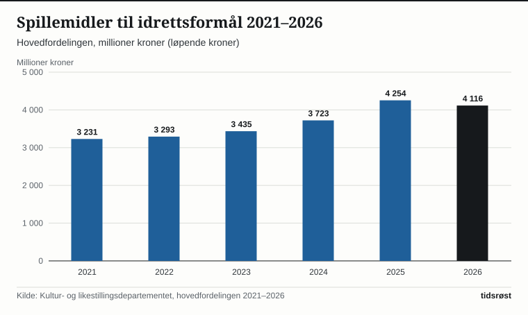
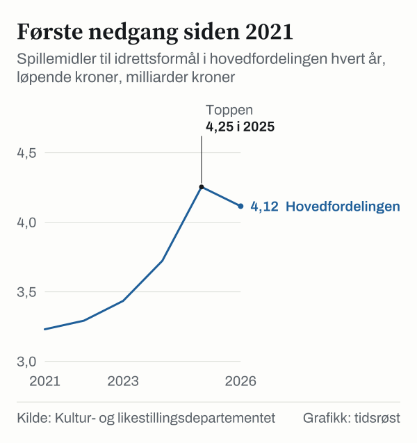

I 2026 får norsk idrett 4 115 669 000 kroner fra overskuddet i Norsk Tipping, etter at fordelingen ble fastsatt i statsråd 7. mai 2026. Litt over halvparten av midlene er øremerket bygging og rehabilitering av idrettsanlegg rundt i landet. Resten fordeles blant annet til Norges idrettsforbund og olympiske og paralympiske komité (NIF), lokale idrettslag og målrettede tiltak som gjør det enklere for barn og unge fra alle familier å delta.

Samlet sett har spillemiddelpotten til idrettsformål vokst med 27 prosent siden 2021 målt i løpende kroner.

## Fordelingsnøkkelen i pengespilloven

Hvordan overskuddet fra Norsk Tipping skal deles, er lovfestet i pengespilloven. Først går 6,4 prosent av overskuddet til helse- og rehabiliteringsformål. Av det resterende beløpet tilfaller 64 prosent idrettsformål, 18 prosent kulturformål og 18 prosent samfunnsnyttige og humanitære organisasjoner. Idrettens andel fordeles hver vår gjennom den såkalte hovedfordelingen etter at Norsk Tipping har avholdt sin generalforsamling.

Slik fordeler Kultur- og likestillingsdepartementet idrettsmidlene i 2026:

| Post | Kroner 2026 | Andel |
|---|---|---|
| Idrettsanlegg (inkl. løypetiltak og utstyr) | 2 094 982 000 | 50,9 % |
| NIF | 965 000 000 | 23,4 % |
| Tilskudd til lokale lag og foreninger | 535 000 000 | 13,0 % |
| Spesielle aktiviteter (bl.a. antidoping) | 185 000 000 | 4,5 % |
| Særskilte tilskudd (bl.a. ekstrainnsats for deltakelse) | 152 500 000 | 3,7 % |
| Nasjonalanlegg og spesielle anlegg | 141 003 000 | 3,4 % |
| Forsknings- og utviklingsarbeid | 42 184 000 | 1,0 % |
| **Totalt** | **4 115 669 000** | **100 %** |

Overføringen til NIF økte fra 930 millioner kroner i 2025 til 965 millioner kroner i 2026, mens 535 millioner kroner går direkte til lokale lag og foreninger. Disse lokale midlene fordeles etter hvor mange innbyggere mellom 6 og 19 år hver enkelt kommune har.

*Spillemidler til idrettsformål etter hovedfordelingen, løpende kroner. Kilde: Kultur- og likestillingsdepartementet.*

## Over to milliarder til lokale anlegg

Idrettsanlegg i kommunene utgjør den klart største enkeltposten. I ordinær hovedfordeling er det satt av 2 016 482 000 kroner, og når departementet legger til 50 millioner kroner fra disponible midler, kommer den samlede utbetalingen opp i 2 066 482 000 kroner.

Tilskuddene finansierer alt fra store flerbrukshaller til mindre nærmiljøanlegg, og dekker som hovedregel inntil en tredjedel av godkjente anleggskostnader. Staten tildeler en økonomisk ramme til hver fylkeskommune, som deretter prioriterer de lokale prosjektene i sin region:

- **Trøndelag fylkeskommune** opplyste 29. mai 2026 at 230 millioner kroner ble fordelt på 243 søknader.
- **Rogaland fylkeskommune** fordelte 220 271 000 kroner.
- **Akershus fylkeskommune** fikk tildelt 201 595 000 kroner fra staten.
- **Vestfold fylkeskommune** fikk tildelt 96 908 000 kroner til lokale prosjekter.
- **Telemark fylkeskommune** fikk tildelt 91 448 000 kroner, og hadde inkludert renter og inndratte midler 100 844 000 kroner til disposisjon.
- **Finnmark fylkeskommune** fikk en ramme på 38 405 000 kroner, og kunne for andre år på rad innvilge 100 prosent av godkjent søknadssum uten ventetid.

For 2026 ble fylkesrammene regnet ut etter en nøkkel der søknadssum veide 50 prosent, befolkning 25 prosent og anleggsdekning 25 prosent. Fra 15. juni 2026 trådte en ny og modernisert anleggsforskrift i kraft, der søknadsbeløp, anleggsdekning og folketall heretter teller en tredjedel hver for å sikre en jevn og forutsigbar fordeling over hele landet.

## Kraftig redusert ventetid og høy byggeaktivitet

Takket være økte spillemiddeloverføringer de siste årene er etterslepet av ferdigbygde anlegg som venter på oppgjør blitt kraftig redusert. Mens ventetiden i 2021 var oppe i nesten tre år, opplyste Kultur- og likestillingsdepartementet 7. mai 2026 at ventetiden nå er «på veg ned mot eit halvt år».

Samtidig er investeringsviljen i kommunene og idrettslagene høy: Fra 2025 til 2026 økte det samlede beløpet for nye søknader med rundt 420 millioner kroner på landsbasis, drevet av nye idrettshaller og nærmiljøanlegg.

– Idrettsanlegga er motoren i den lokale idretten, uttalte kultur- og likestillingsminister Lubna Jaffery (Ap) da årets tildeling ble lagt fram.

## Bred deltakelse og målrettet innsats for inkludering

Statistisk sentralbyrås (SSB) undersøkelse *Barn si fritid* viser at mer enn sju av ti barn i Norge er med i idretten: 72,2 prosent av alle barn mellom 6 og 15 år oppga at de deltok i organisert idrett – 78,2 prosent blant 6–11-åringene og 63,8 prosent blant 12–15-åringene.

Tallene gir samtidig et nyttig kunnskapsgrunnlag for hvordan myndighetene og idrettsbevegelsen målretter arbeidet for å få med enda flere barn uavhengig av familieøkonomi:

*Andel barn 6–15 år som driver med organisert idrett, 2024. Kilde: SSB, tabell 14416.*

Også blant voksne har treningsaktiviteten økt betydelig over tid. I SSBs levekårsstatistikk oppgir hele 78 prosent av befolkningen fra 16 år og oppover at de trener ukentlig eller oftere, opp fra 58 prosent i 1998.

## Slik styrker midlene hverdagen i idrettslagene

For idrettslag og kommuner som bygger nye kunstgressbaner, svømmeanlegg, haller eller lysløyper, betyr den kraftig forkortede ventetiden langt lavere renteutgifter på mellomfinansiering før statstilskuddet utbetales.

For barnefamilier gir potten på 535 millioner kroner i direkte grunnstøtte til lokale lag og foreninger et viktig bidrag til å holde treningsavgiftene lave og breddetilbudet åpent. I tillegg har regjeringen satt av 150 millioner kroner til en permanent støtteordning – etablert som fast ordning i 2025 – som går målrettet til idrettslag for å inkludere barn og unge og redusere kostnader til utstyr og deltakelse.

## Kilder

- [Kultur- og likestillingsdepartementet: Årets fordeling av spelemidlar til idretten er klar (pressemelding 7. mai 2026)](https://www.regjeringen.no/no/aktuelt/arets-fordeling-av-spelemidlar-til-idretten-er-klar/id3158776/)
- [Kultur- og likestillingsdepartementet: Fordeling av spillemidler til idrettsformål (Hovedfordelingen), med tabeller 2021–2026](https://www.regjeringen.no/no/dep/kud/tilskudd/Fordeling-av-spillemidler-til-idrettsformal-Hovedfordelingen/id764857/)
- [Hovedfordelingen av spillemidler til idrettsformål 2026 (PDF)](https://www.regjeringen.no/contentassets/bea6418f69404de4ba0baa79192fbcbb/hovedfordelingen-av-spillemidler-til-idrettsformal-2026.pdf)
- [Spillemidler til idrettsformål – hovedfordelingen 2025 (PDF)](https://www.regjeringen.no/contentassets/bea6418f69404de4ba0baa79192fbcbb/spillemidler-til-idrettsformal-hovedfordelingen-2025.pdf)
- [Prop. 1 S (2025–2026) for Kultur- og likestillingsdepartementet (PDF)](https://www.regjeringen.no/contentassets/10cf7bc0012f4aae94edda040d54b011/no/pdfs/prp202520260001kuddddpdfs.pdf)
- [Lovdata: Forskrift om tilskudd til bygging og rehabilitering av anlegg for idrett og fysisk aktivitet (anleggsforskriften)](https://lovdata.no/dokument/SF/forskrift/2026-06-05-1024)
- [Rogaland fylkeskommune: 220 millioner kroner til idrettsanlegg og nærmiljøanlegg](https://www.rogfk.no/vare-tjenester/kultur-idrett-og-friluftsliv/aktuelt-kultur-idrett-og-friluftsliv/220-millioner-kroner-til-idrettsanlegg-og-narmiljoanlegg.158837.aspx)
- [Akershus fylkeskommune: 201 millioner fordeles til anlegg for idrett og fysisk aktivitet](https://afk.no/aktuelt/201-millioner-fordeles-til-anlegg-for-idrett-og-fysisk-aktivitet.229306.aspx)
- [Vestfold fylkeskommune: Fordeling av spillemidler til anlegg for idrett og fysisk aktivitet 2026 (saksframlegg)](https://sru.vestfoldfylke.prokom.no/api/utvalg/200294/moter/548584/behandlinger/1/0)
- [Telemark fylkeskommune: Fordeling av spillemidler til anlegg for idrett og fysisk aktivitet 2026 (saksframlegg)](https://sru.telemarkfylke.prokom.no/api/utvalg/200088/moter/510632/behandlinger/17/0)
- [Finnmark fylkeskommune: Full tildeling av spillemidler for andre år på rad](https://www.ffk.no/tjenester/folkehelse-idrett-og-friluftsliv/aktuelt-folkehelse-idrett-og-friluftsliv/full-tildeling-av-spillemidler-for-andre-ar-pa-rad-ma-ingen-vente.70671.aspx)
- [Trøndelag fylkeskommune: 230 millioner til idrettsanlegg i Trøndelag](https://www.trondelagfylke.no/vare-tjenester/folkehelse-idrett-frivillighet/idrett/nyheter/230-millioner-til-idrettsanlegg-i-trondelag/)
- [SSB: Fattigere barn driver mindre med idrett (2. desember 2025)](https://www.ssb.no/sosiale-forhold-og-kriminalitet/levekar/artikler/fattigere-barn-driver-mindre-med-idrett)
- [SSB: Tabell 14416, Foreldres inntekt og organiserte treningsaktivitetar blant barn og unge](https://www.ssb.no/statbank/table/14416)
- [SSB: Tabell 14412, Kjønn, alder og organiserte treningsaktivitetar blant barn og unge](https://www.ssb.no/statbank/table/14412)
- [SSB: Tabell 06181, Levevaner etter kjønn og alder](https://www.ssb.no/statbank/table/06181)
