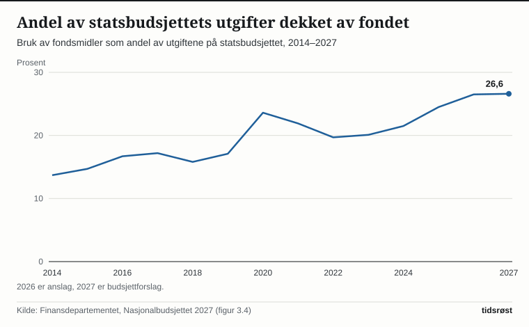

I sitt forslag til statsbudsjett for 2027, lagt fram 7. oktober 2026, foreslår regjeringen å bruke 608,4 milliarder kroner fra Statens pensjonsfond utland. Med en beregningsteknisk anslått fondsverdi på 22 400 milliarder kroner ved inngangen til 2027 tilsvarer uttaket 2,7 prosent av fondet – innenfor handlingsregelen og under den forventede realavkastningen på 3 prosent. Forslaget ligger nå til behandling i Stortinget.

## Slik virker handlingsregelen

Handlingsregelen legger til grunn at oljepengebruken over tid skal følge den forventede realavkastningen av fondet. Siden 2018 har dette avkastningsanslaget ligget på 3 prosent, etter at det tidligere var satt til 4 prosent.

Det offisielle målet for oljepengebruken er det strukturelle, oljekorrigerte budsjettunderskuddet. Dette tallet viser hvor stort statens underskudd er når petroleumsinntektene holdes utenfor, og når det samtidig korrigeres for konjunktursvingninger i skatter, avgifter og arbeidsledighetstrygd. I Nasjonalbudsjettet 2027 peker Finansdepartementet på at uttaket bør holdes under 3 prosent i normale konjunkturer, og viser til analyser der et uttak på 2,7 prosent tilsvarer forventet realavkastning over tid.

Selve den faktiske overføringen fra oljefondet til statskassen – det ujusterte oljekorrigerte underskuddet – er anslått til 561,7 milliarder kroner i 2027.

*Uttaket fra fondet har ligget under 3 prosent de fleste år siden 2015, med unntak av 2020 og 2021. Kilde: Finansdepartementet, Nasjonalbudsjettet 2027.*

## Doblet bidrag til fellesvelferden siden 2014

I takt med at oljefondet har vokst kraftig i verdi, har også de årlige overføringene til statsbudsjettet økt innenfor handlingsregelens rammer. Det strukturelle underskuddet endte på 507,4 milliarder kroner i 2025, og er for 2026 anslått til 583,4 milliarder kroner – omtrent på linje med revidert nasjonalbudsjett.

| År | Mrd. kr (løpende priser) | Mrd. 2027-kroner | Prosent av fondet | Prosent av trend-BNP for Fastlands-Norge |
|---|---|---|---|---|
| 2025 | 507,4 | 545,7 | 2,6 | 11,6 |
| 2026 (anslag) | 583,4 | 603,5 | 2,7 | 12,7 |
| 2027 (forslag) | 608,4 | 608,4 | 2,7 | 12,6 |

*Kilde: Finansdepartementet, nøkkeltall i Nasjonalbudsjettet 2027.*

Regnet i faste 2027-priser øker fondsbruken med 4,9 milliarder kroner fra 2026 til 2027. Målt som andel av verdiskapingen i fastlandsøkonomien (trend-BNP) er oljepengebruken uendret, med en budsjettindikator på 0,0, og den reelle, underliggende utgiftsveksten i statsbudsjettet er beregnet til 0,2 prosent. Ifølge Finansdepartementet går deler av fondsuttaket til skatte- og avgiftslettelser, slik at budsjettet samlet sett virker tilnærmet nøytralt på den økonomiske aktiviteten.

Over tid har avkastningen fra fondet gitt et stadig større bidrag til finansieringen av fellesoppgavene. Mens fondsmidlene dekket 13,7 prosent av statens utgifter i 2014, er andelen anslått til 26,6 prosent i 2027. I Nasjonalbudsjettet framheves det at oljekronene har finansiert et bredt offentlig tjenestetilbud, og at handlingsregelens ramme sikrer en jevn og forutsigbar innfasing også når de internasjonale finansmarkedene svinger.

*Fondet finansierer i dag mer enn hver fjerde utgiftskrone på statsbudsjettet. Kilde: Finansdepartementet, Nasjonalbudsjettet 2027.*

## Forsvar, Ukraina og folketrygd topper utgiftssiden

Utenom lånetransaksjoner er statens samlede utgifter i 2027 anslått til 2 322 milliarder kroner og inntektene til 2 328 milliarder kroner. Holdes petroleumsvirksomheten utenfor, beløper utgiftene seg til 2 287 milliarder kroner.

Folketrygden er den klart største utgiftsposten med 794,1 milliarder kroner – der alderspensjonene alene utgjør 378,2 milliarder. Deretter følger rammetilskuddene til kommuner og fylkeskommuner (277,6 milliarder kroner), de regionale helseforetakene (250,4 milliarder) og forsvaret (191,7 milliarder).

Blant hovedgrepene i regjeringens budsjettforslag er:

- **Forsvar:** 6,5 milliarder kroner i økte bevilgninger i tråd med langtidsplanen, slik at forsvarsutgiftene anslås til 3,4 prosent av BNP i 2027.
- **Ukraina:** 85 milliarder kroner gjennom Nansen-programmet, regnet inn i det strukturelle fondsuttaket.
- **Kommuner og sykehus:** 3,2 milliarder kroner i økte frie inntekter til kommunesektoren og 3,1 milliarder kroner mer til sykehusene.
- **Strømtiltak:** Videreføring av både strømstønaden og Norgespris, med en samlet kostnadsramme for husholdningene på i underkant av 16,4 milliarder kroner.

Finansminister Jens Stoltenberg (Ap) oppsummerte rammen slik da budsjettet ble lagt fram: «Bruken av fondsmidler er i tråd med handlingsregelen og klart under den forventede realavkastningen på tre prosent.»

## Skattelettelser på arbeidsinntekt og grønn avgiftsomlegging

På skattesiden foreslår regjeringen å lette inntektsskatten for personer med 6,4 milliarder kroner. Hovedgrepet er et kutt i trygdeavgiften på 0,2 prosentpoeng, som alene utgjør 4,9 milliarder kroner, kombinert med at personfradraget heves til 120 180 kroner.

Samtidig videreføres den planlagte innfasingen av merverdiavgift for de dyreste elbilene etter at elbilandelen i nybilsalget har passert 97 prosent: Beløpsgrensen for momsfritak foreslås satt til 150 000 kroner i 2027, mens veibruksavgiften på bensin, mineralolje og biodiesel foreslås satt ned med 50 øre per liter.

Isolert sett gir de nye skatte- og avgiftsforslagene en samlet lettelse på 1,8 milliarder kroner i 2027. Regnet sammen med helårsvirkningen av endringer som ble vedtatt i 2026, holdes det samlede skatte- og avgiftsnivået stabilt – i tråd med regjeringens skatteløfte.

## Slik slår budsjettforslaget ut for husholdningene

For vanlige lønnstakere gir kuttet i trygdeavgiften og det økte personfradraget lavere skattetrekk: Ifølge regjeringens beregninger vil en familie med to inntekter på 750 000 kroner hver få 3 500 kroner lavere skatt med det foreslåtte opplegget.

Størrelsen på oljepengebruken bidrar også til stabilitet i norsk økonomi. Finansdepartementet framholder at et konjunkturnøytralt budsjett støtter opp under arbeidet med å bringe prisveksten videre ned uten å legge ekstra press på rentesettingen i Norges Bank. Det endelige statsbudsjettet for 2027 vedtas av Stortinget før jul.

## Kilder

- [Finansdepartementet: Et budsjett som trygger Norge i en utrygg tid (pressemelding, 7.10.2026)](https://www.regjeringen.no/no/aktuelt/et-budsjett-som-trygger-norge-i-en-utrygg-tid/id3174614/)
- [Finansdepartementet: Nøkkeltall i nasjonalbudsjettet 2027 (pressemelding, 7.10.2026)](https://www.regjeringen.no/no/aktuelt/nokkeltall-i-nasjonalbudsjettet-2027/id3174610/)
- [Meld. St. 1 (2026–2027) Nasjonalbudsjettet 2027, kapittel 3 Budsjettpolitikken](https://www.regjeringen.no/no/dokumenter/meld.-st.-1-20262027/id3175768/?ch=3)
- [Finansdepartementet: Statsbudsjettet 2027 – Statens inntekter og utgifter](https://www.regjeringen.no/no/statsbudsjett/2027/statsbudsjettet-2027-statens-inntekter-og-utgifter/id3173250/)
- [Finansdepartementet: Statsbudsjettet 2027 – Provenyvirkninger av skatte- og avgiftsendringer for 2027](https://www.regjeringen.no/no/statsbudsjett/2027/statsbudsjettet-2027-skatter-og-avgifter/statsbudsjettet-2027-provenyvirkninger-av-skatte-og-avgiftsendringer-for-2027/id3173279/)
- [Finansdepartementet: Hvor mye av olje- og gassinntektene bruker vi?](https://www.regjeringen.no/no/tema/okonomi-og-budsjett/norsk_okonomi/bruk-av-oljepenger-/hvor-mye-av-olje--og-gassinntektene-bruker-vi/id450461/)
