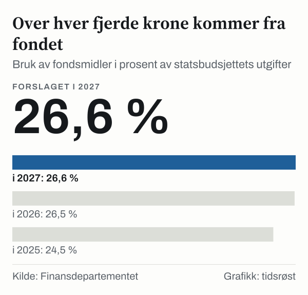

I forslaget til statsbudsjett for 2027, lagt fram 7. oktober 2026, foreslår regjeringen å bruke 608,4 milliarder kroner fra Statens pensjonsfond utland. Fondsmidlene dekker anslagsvis 26,6 prosent av statsbudsjettets utgifter, altså mer enn hver fjerde krone. Med en beregningsteknisk anslått fondsverdi på 22 400 milliarder kroner ved inngangen til 2027 tilsvarer bruken 2,7 prosent av fondet. Forslaget ligger nå til behandling i Stortinget.

*Bruk av fondsmidler i prosent av statsbudsjettets utgifter. Tallet for 2026 er et anslag og tallet for 2027 regjeringens forslag. Kilde: Finansdepartementet, Nasjonalbudsjettet 2027.*

## Hvor mye som brukes

Det strukturelle underskuddet endte på 507,4 milliarder kroner i 2025, og er for 2026 anslått til 583,4 milliarder kroner.

| År | Mrd. kr (løpende priser) | Mrd. 2027-kroner | Prosent av fondet | Prosent av trend-BNP for Fastlands-Norge |
|---|---|---|---|---|
| 2025 | 507,4 | 545,7 | 2,6 | 11,6 |
| 2026 (anslag) | 583,4 | 603,5 | 2,7 | 12,7 |
| 2027 (forslag) | 608,4 | 608,4 | 2,7 | 12,6 |

*Kilde: Finansdepartementet, nøkkeltall i Nasjonalbudsjettet 2027.*

Regnet i faste 2027-priser øker fondsbruken med 4,9 milliarder kroner fra 2026 til 2027. Målt som andel av trend-BNP for Fastlands-Norge er oljepengebruken uendret, med en budsjettindikator på 0,0, og den reelle, underliggende utgiftsveksten i statsbudsjettet er beregnet til 0,2 prosent. Finansdepartementet anslår at budsjettet har en om lag nøytral effekt på aktiviteten i økonomien.

Selve overføringen fra oljefondet til statskassen, det ujusterte oljekorrigerte underskuddet, er anslått til om lag 562 milliarder kroner i 2027.

## De store postene

Utenom lånetransaksjoner er statens samlede utgifter i 2027 anslått til 2 322 milliarder kroner og inntektene til 2 328 milliarder kroner. Holdes petroleumsvirksomheten utenfor, er utgiftene 2 287 milliarder kroner.

Folketrygden er den største utgiftsposten med 794,1 milliarder kroner, der alderspensjonene alene utgjør 378,2 milliarder. Deretter følger rammetilskuddene til kommuner og fylkeskommuner (277,6 milliarder kroner), de regionale helseforetakene (250,4 milliarder) og samferdsel (99,9 milliarder).

![Stolpediagram over Folketrygden er den klart største posten: Utgifter: Folketrygden: 794,1 milliarder kroner, Rammetilskudd til kommunesektoren: 277,6 milliarder kroner, Regionale helseforetak: 250,4 milliarder kroner, Samferdsel: 99,9 milliarder kroner, Høyere utdanning og forskning: 68,6 milliarder kroner, Bistand: 53,4 milliarder kroner, Politi og påtalemyndighet: 33,6 milliarder kroner, Jordbruksavtalen: 33,4 milliarder kroner, Barnetrygd og kontantstøtte: 30,8 milliarder kroner, Renter på statsgjeld: 24,4 milliarder kroner.](./graf-2.svg)
*Utvalgte utgiftsposter i statsbudsjettet 2027, milliarder kroner, utenom lånetransaksjoner og petroleumsvirksomheten. Samlede utgifter utenom petroleum er 2 286,8 milliarder kroner. Kilde: Finansdepartementet, Statsbudsjettet 2027, tabell 1.*

## Hva som endres

- **Kommuner og sykehus:** 3,2 milliarder kroner i økte frie inntekter til kommunesektoren og 3,1 milliarder kroner mer til sykehusene.
- **Strømtiltak:** Strømstønaden dekker 90 prosent av kostnadene over 79 øre per kilowattime før avgifter, og Norgespris settes til 45 øre per kilowattime pluss avgifter i 2027. Strømstøtteordningene for husholdningene er anslått å koste i underkant av 16,4 milliarder kroner.
- **Inntektsskatt:** Regjeringen foreslår å redusere inntektsskatten for personer med 6,4 milliarder kroner. Nedsettelsen av trygdeavgiften med 0,2 prosentpoeng utgjør alene 4,9 milliarder kroner, og personfradraget heves til 120 180 kroner.
- **Avgifter:** Beløpsgrensen for momsfritak for elbiler foreslås senket fra 300 000 til 150 000 kroner, mens veibruksavgiften på bensin, mineralolje og biodiesel foreslås satt ned med 50 øre per liter.

Isolert sett gir de nye skatte- og avgiftsforslagene en samlet reduksjon på 1,8 milliarder kroner i 2027. Regnet sammen med helårsvirkningen av tiltak fra 2026 blir den samlede endringen i skatter og avgifter tilnærmet null.

## Slik virker handlingsregelen

Handlingsregelen legger til grunn at oljepengebruken over tid skal følge den forventede realavkastningen av fondet. Forventet realavkastning ble satt ned fra 4 til 3 prosent i Perspektivmeldingen 2017. I Nasjonalbudsjettet 2027 skriver Finansdepartementet at uttaket bør være under 3 prosent i normale tider, og at et uttak på 2,7 prosent over tid tilsvarer en forventet realavkastning på 3 prosent.

Det offisielle målet for oljepengebruken er det strukturelle, oljekorrigerte budsjettunderskuddet. Det viser statens underskudd når petroleumsinntektene holdes utenfor, korrigert for konjunktursvingninger i skatter, avgifter og arbeidsledighetstrygd.

## Hva tallene ikke viser

Tallene er regjeringens forslag. Stortinget behandler budsjettet, og statsbudsjettet for 2027 vedtas normalt i desember. Beløpene kan derfor endres.

## Kilder

- [Finansdepartementet: Pressemelding om statsbudsjettet 2027 (7.10.2026)](https://www.regjeringen.no/no/aktuelt/et-budsjett-som-trygger-norge-i-en-utrygg-tid/id3174614/)
- [Finansdepartementet: Nøkkeltall i nasjonalbudsjettet 2027 (pressemelding, 7.10.2026)](https://www.regjeringen.no/no/aktuelt/nokkeltall-i-nasjonalbudsjettet-2027/id3174610/)
- [Meld. St. 1 (2026–2027) Nasjonalbudsjettet 2027, kapittel 3 Budsjettpolitikken](https://www.regjeringen.no/no/dokumenter/meld.-st.-1-20262027/id3175768/?ch=3)
- [Finansdepartementet: Statsbudsjettet 2027 – Statens inntekter og utgifter](https://www.regjeringen.no/no/statsbudsjett/2027/statsbudsjettet-2027-statens-inntekter-og-utgifter/id3173250/)
- [Finansdepartementet: Statsbudsjettet 2027 – Provenyvirkninger av skatte- og avgiftsendringer for 2027](https://www.regjeringen.no/no/statsbudsjett/2027/statsbudsjettet-2027-skatter-og-avgifter/statsbudsjettet-2027-provenyvirkninger-av-skatte-og-avgiftsendringer-for-2027/id3173279/)
- [Finansdepartementet: Hvor mye av olje- og gassinntektene bruker vi?](https://www.regjeringen.no/no/tema/okonomi-og-budsjett/norsk_okonomi/bruk-av-oljepenger-/hvor-mye-av-olje--og-gassinntektene-bruker-vi/id450461/)
