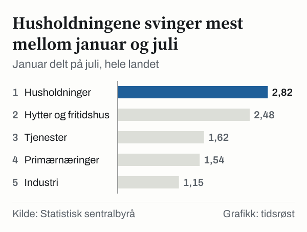
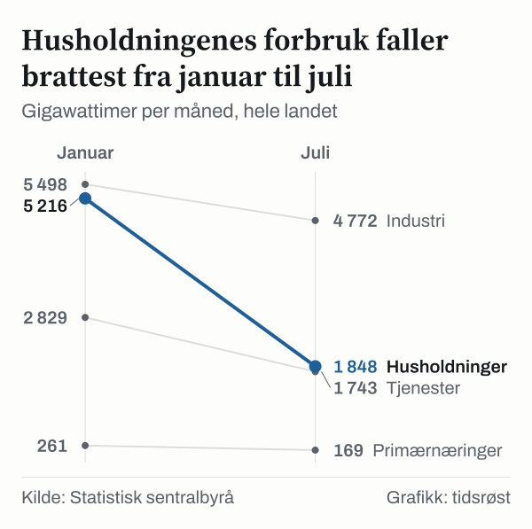
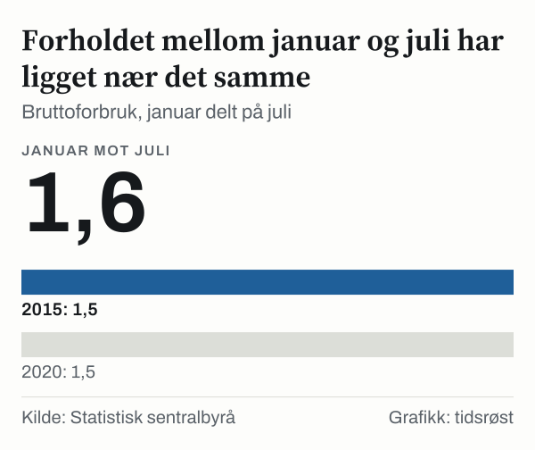

Hvor mye mer strøm brukte Norge i januar enn i juli? Svaret er 1,6 ganger så mye i 2025. Bruttoforbruket av elektrisk kraft var 14 753 GWh i januar og 9 222 GWh i juli, ifølge Statistisk sentralbyrå (SSB). Bruttoforbruket er nettoforbruket pluss forbruk til pumpekraft og nettap, slik SSB deler det i tabellen.

Forskjellen mellom vinter og sommer kommer ikke fra alle forbrukerne. Husholdningene brukte 5 216 GWh i januar og 1 848 GWh i juli, altså 2,8 ganger så mye om vinteren. Industrien og annen sekundærnæring brukte 5 498 GWh i januar og 4 772 GWh i juli, bare 1,2 ganger så mye.

Her følger vi året 2025 fra januar til desember, måned for måned. Det handler om hvem som bruker strømmen, hvor mye som produseres og hvor mye som går over landegrensene. Mot slutten ser vi på de første månedene i året 2026. Tallene gjelder hele landet og alle forbrukere, ikke den enkelte husholdningen.

## Januar til mai: boligene bruker stadig mindre

Januar var måneden Norge brukte mest strøm. Bruttoforbruket var 14 753 GWh. Kraftverkene leverte 17 368 GWh, mer enn landet brukte, og mellomlegget gikk ut av landet. Eksporten var 3 464 GWh og importen 849 GWh. Forskjellen mellom dem, som vi kaller netto eksport, var 2 615 GWh. Bruttoforbruket var høyere i januar enn i noen annen måned.

Husholdningene sto for 5 216 GWh av forbruket, sekundærnæringene for 5 498 GWh og tertiærnæringene for 2 829 GWh. Tertiærnæringene er de tjenesteytende næringene, som butikker, kontorer og offentlige bygg. Det er de tre største forbrukergruppene i SSBs tabell. Figuren under viser tre av dem og netto eksport for alle tolv måneder. 

![Små linjediagrammer over Husholdningene har den dypeste dalen gjennom året: Husholdninger: jan.: 5 216, feb.: 4 513, mars: 4 157, apr.: 3 187, mai: 2 703, juni: 2 219, juli: 1 848, aug.: 2 102, sep.: 2 338, okt.: 3 296, nov.: 4 173, des.: 4 656; Tjenester: jan.: 2 829, feb.: 2 489, mars: 2 431, apr.: 2 016, mai: 1 910, juni: 1 747, juli: 1 743, aug.: 1 814, sep.: 1 901, okt.: 2 263, nov.: 2 513, des.: 2 638; Industri: jan.: 5 498, feb.: 4 999, mars: 5 411, apr.: 4 947, mai: 4 849, juni: 4 689, juli: 4 772, aug.: 5 072, sep.: 4 808, okt.: 5 126, nov.: 5 263, des.: 5 366; Netto eksport: jan.: 2 615, feb.: 2 865, mars: 1 967, apr.: 2 003, mai: 1 259, juni: 1 222, juli: 2 242, aug.: 1 450, sep.: 1 702, okt.: 1 562, nov.: 1 905, des.: 2 007.](./graf-1.svg)
*Gigawattimer per måned, hele landet. Kilde: Statistisk sentralbyrå.*

Fra januar til mai falt husholdningenes forbruk hver eneste måned. Det var 5 216 GWh i januar, 4 513 GWh i februar, 4 157 GWh i mars, 3 187 GWh i april og 2 703 GWh i mai. I mai var forbruket 48,2 prosent lavere enn i januar.

Tjenestenæringene fulgte samme retning, men tallene er mindre: fra 2 829 GWh i januar til 1 910 GWh i mai. Industrien skiller seg ut. Den brukte 5 498 GWh i januar og 4 849 GWh i mai, og det er 11,8 prosent lavere.

Netto eksport var størst i februar, med 2 865 GWh, og falt til 1 259 GWh i mai. Den laveste verdien i hele året kom i juni, med 1 222 GWh. Tallene viser at Norge sendte mer strøm ut enn inn i alle disse månedene, men mengden varierte med årstiden.

## Juli: bunnen for forbruket, ikke for eksporten

Juli var måneden med lavest bruttoforbruk, 9 222 GWh. Husholdningene brukte 1 848 GWh, det laveste for noen måned, og 64,6 prosent mindre enn i januar. Tertiærnæringene brukte 1 743 GWh, og industrien 4 772 GWh. I juni brukte tjenestenæringene 1 747 GWh og husholdningene 2 219 GWh. Industrien brukte 5 072 GWh i august og 4 808 GWh i september. Primærnæringene, som landbruk, fiske og skogbruk, er den minste gruppen. De brukte 261 GWh i januar og 169 GWh i juli. Selv om gruppen er liten, ligger forholdet mellom de to månedene høyere enn for industrien.

Forskjellen mellom husholdningenes største og minste måned var 3 368 GWh. For industrien var den tilsvarende forskjellen 809 GWh, mellom 5 498 GWh i januar og 4 689 GWh i juni. Forholdet mellom januar og juli gir en enkel måte å sammenligne gruppene på. Husholdningene har 2,8, hytter og fritidshus 2,5, tertiærnæringene 1,6 og primærnæringene 1,5. Sekundærnæringene har 1,2. Hytter og fritidshus er en del av husholdningstallet. De brukte 327 GWh i januar og 131 GWh i juli, og svinger litt mindre enn boligene.

*Januar delt på juli, hele landet. Kilde: Statistisk sentralbyrå.*

Eksporten fulgte ikke forbruket ned. I juli var eksporten 3 095 GWh, mot 2 301 GWh i juni. Importen var 853 GWh i juli, og netto eksport steg til 2 242 GWh, fra 1 222 GWh i juni. Månedstallene sier hvor mye som gikk over grensen, ikke hvorfor det varierte.

## Hvor strømmen kommer fra om vinteren og om sommeren

Produksjonen svinger også. Samlet produksjon var 17 368 GWh i januar og 11 464 GWh i juli, 1,5 ganger så mye om vinteren. Vannkraften sto for 15 779 GWh av produksjonen i januar og 10 809 GWh i juli, 1,5 ganger så mye om vinteren.

Vindkraften svinger mer enn vannkraften. Den produserte 1 415 GWh i januar og 452 GWh i juli, 3,1 ganger så mye om vinteren. Vindkraftens andel av produksjonen var 8,1 prosent i januar og 3,9 prosent i juli. Vannkraftens andel var 90,9 prosent i januar og 94,3 prosent i juli. Vannkraften sto for over ni tideler av produksjonen i begge månedene, mens vindkraften bidro mest i vintermåneden.

Setter vi januar mot juli, svinger husholdningenes forbruk 2,8 ganger, mens samlet produksjon svinger 1,5 ganger.

*Gigawattimer per måned, hele landet. Kilde: Statistisk sentralbyrå.*

## Høsten: forbruket tar seg opp igjen

Fra august gikk husholdningenes forbruk opp igjen. Det var 2 102 GWh i august, 2 338 GWh i september, 3 296 GWh i oktober, 4 173 GWh i november og 4 656 GWh i desember. Husholdningene brukte 5 216 GWh i januar og 4 656 GWh i desember. Forbruket i desember var 10,7 prosent lavere enn i januar. Tjenestenæringene brukte 2 829 GWh i januar og 2 638 GWh i desember.

Tjenestenæringene brukte 2 263 GWh i oktober, 2 513 GWh i november og 2 638 GWh i desember. Industrien lå på 5 126 GWh i oktober og 5 366 GWh i desember. Bruttoforbruket i desember var 13 775 GWh. Eksporten var 3 299 GWh, og importen 1 292 GWh, den høyeste importen i noen måned i 2025. Netto eksport var 2 007 GWh.

Når vi legger sammen januar, februar og desember, får vi 41 567 GWh. Bruttoforbruket for hele året var 138 993 GWh. De tre vintermånedene sto dermed for 29,9 prosent av året. Tre måneder utgjør en fjerdedel av året, så vinterandelen ligger nær fem prosentpoeng over det en jevn fordeling ville gitt.

## Har sesongutslaget endret seg?

Det går an å sammenligne med tidligere år. Bruttoforbruket var 13 591 GWh i januar 2015, og i juli samme år 9 052 GWh. Det gir et forhold på 1,5. Fem år senere var tallene 13 457 GWh i januar og 9 000 GWh i juli, også 1,5. I 2025 var forholdet 1,6.

En forskjell på 0,1 er liten. Tre år er også for lite til å si at mønsteret har endret seg. Vi valgte årene med fem års mellomrom, og et annet utvalg kunne gitt et annet bilde. Det vi kan si er at sesongutslaget i bruttoforbruket har ligget nær det samme i de tre årene vi har sett på.

*Bruttoforbruk, januar delt på juli. Kilde: Statistisk sentralbyrå.*

Tallene er ikke justert for temperatur, og vi har ikke undersøkt hva som ligger bak økningen fra 1,5 til 1,6. Vi tolker den ikke som en endring i hvordan folk bruker strøm.

## Tre måneder med importoverskudd

I 2025 var eksporten større enn importen hver måned. Januar 2026 var høy: bruttoforbruket var 9,7 prosent høyere enn i januar 2025, og husholdningene brukte 16,9 prosent mer. I januar var importen 860 GWh og eksporten 2 460 GWh, så eksporten var 1 600 GWh større.

I februar var importen 1 774 GWh og eksporten 991 GWh, så importen var 783 GWh større. I mars var importen 2 375 GWh og eksporten 1 780 GWh, en forskjell på 594 GWh. I april var importen 2 176 GWh og eksporten 1 513 GWh, en forskjell på 663 GWh.

Etter april var eksporten igjen større enn importen i hver måned til og med september. I mai var importen 1 463 GWh og eksporten 2 184 GWh, så eksporten var 722 GWh større. Forskjellen var 1 482 GWh i juni, 919 GWh i juli, 482 GWh i august og 643 GWh i september.

Vannkraftproduksjonen var lavere enn året før i februar, mars og april. I februar var den 12 127 GWh, mot 14 496 GWh i februar 2025, en nedgang på 16,3 prosent. I mars var den 10 656 GWh, mot 13 399 GWh i mars 2025, en nedgang på 20,5 prosent. I april var den 8 958 GWh, mot 11 809 GWh i april 2025, en nedgang på 24,1 prosent.

Tabellen sier ikke hvorfor importen var høyere eller hvorfor produksjonen var lavere. SSB har publisert månedstall til og med september 2026, og tallene kan endres ved senere revisjoner.

## Det månedstallene ikke kan svare på

Tabellen gir månedlige summer. Den sier ingenting om hva som skjedde fra døgn til døgn eller time til time.

Hvorfor forbruket varierer, har vi heller ikke undersøkt. Tabellen inneholder ikke temperatur, daglengde eller opplysninger om vaner. Gruppeinndelingen er SSBs: primærnæringer, sekundærnæringer, tertiærnæringer og husholdninger. Hytter og fritidshus er en del av husholdningene.

Til slutt er dette ett års månedstall og to enkeltmåneder for to tidligere år. Det er for lite til å si noe om andre år enn de vi har sett på.

## Slik regnet vi

Vi brukte SSBs tabell for elektrisitetsbalanse med månedlige tall i megawattimer. Vi delte tallene på tusen og viser dem som gigawattimer, avrundet til hele tall. Dataene dekker alle tolv måneder i året 2025, januar og juli for to tidligere år, og månedene fra januar til september i 2026.

Forholdstallet for en forbrukergruppe er januar delt på juli. Netto eksport er eksport minus import. Prosentvise endringer er regnet fra første til andre verdi. Vintermånedene er januar, februar og desember. Vinterandelen er summen av bruttoforbruket de tre månedene delt på summen for alle tolv måneder. Alle tall er hentet fra SSBs åpne API 23. oktober 2026.

## Kilder

- [SSB: Elektrisitetsbalanse, månedlige tall](https://www.ssb.no/statbank/table/14091)
