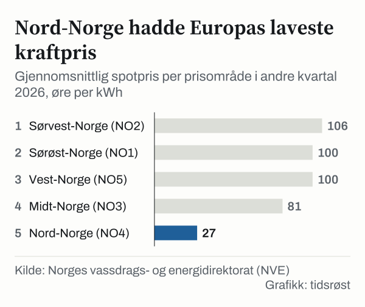

I 2. kvartal 2026 betalte husholdningene i gjennomsnitt 117,9 øre/kWh for strøm etter støtte, inkludert nettleie og avgifter, viser tall fra Statistisk sentralbyrå (SSB). Før støtte var prisen 173,2 øre/kWh, slik at støtteordningene Norgespris og strømstønad gjorde prisen 32 prosent lavere. Samtidig var forskjellene i engrosmarkedet store: Selve kraften kostet i snitt 106 øre/kWh i Sørvest-Norge og 27 øre/kWh i Nord-Norge, ifølge Norges vassdrags- og energidirektorat (NVE).

## Hva betalte husholdningene?

117,9 øre/kWh i snitt etter støtte i 2. kvartal 2026, 6,6 prosent mindre enn i samme kvartal året før. Før støtte var totalprisen 173,2 øre/kWh: 100,1 øre for kraften (uten mva.), 33,9 øre i nettleie og 39,2 øre i avgifter. Støtteordningene trakk prisen ned med 55,3 øre/kWh i snitt, mot 4,8 øre/kWh i 2. kvartal 2025.

Uten støtteordningene måtte man tilbake til 2022 for å finne en høyere strømpris i 2. kvartal, opplyser SSB.

![Linjediagram over Støtten trakk prisen kraftig ned i 2026: Før støtte: 1. kvartal 2022: 188,8, 2. kvartal 2022: 205,3, 3. kvartal 2022: 317,6, 4. kvartal 2022: 264,9, 1. kvartal 2023: 182,3, 2. kvartal 2023: 160,1, 3. kvartal 2023: 114,9, 4. kvartal 2023: 162,9, 1. kvartal 2024: 148,6, 2. kvartal 2024: 130,4, 3. kvartal 2024: 112,4, 4. kvartal 2024: 134,7, 1. kvartal 2025: 139,2, 2. kvartal 2025: 131,0, 3. kvartal 2025: 139,3, 4. kvartal 2025: 152,8, 1. kvartal 2026: 195,1, 2. kvartal 2026: 173,2; Etter støtte: 1. kvartal 2022: 133,5, 2. kvartal 2022: 137,3, 3. kvartal 2022: 141,5, 4. kvartal 2022: 162,2, 1. kvartal 2023: 143,8, 2. kvartal 2023: 143,5, 3. kvartal 2023: 113,9, 4. kvartal 2023: 136,2, 1. kvartal 2024: 137,5, 2. kvartal 2024: 127,6, 3. kvartal 2024: 112,3, 4. kvartal 2024: 124,4, 1. kvartal 2025: 122,5, 2. kvartal 2025: 126,2, 3. kvartal 2025: 132,3, 4. kvartal 2025: 123,6, 1. kvartal 2026: 122,0, 2. kvartal 2026: 117,9.](./graf-1.svg)
*Gjennomsnittlig strømpris for husholdninger per kvartal, inkludert nettleie og avgifter, før og etter støtte fra myndighetene, 1. kvartal 2022–2. kvartal 2026. Kilde: SSB, tabell 09387.*

SSBs husholdningsstatistikk oppgis kun som et landsgjennomsnitt og brytes ikke ned på prisområdene.

## Hvorfor er prisen ulik i nord og sør?

Fem prisområder: Fordi overføringskapasiteten i strømnettet setter grenser for hvor mye kraft som kan fraktes mellom landsdelene, er Norge delt inn i fem prisområder. I 2. kvartal 2026 var snittprisen i engrosmarkedet 100 øre/kWh i Sørøst-Norge (NO1) og Vest-Norge (NO5), 106 øre i Sørvest-Norge (NO2), 81 øre i Midt-Norge (NO3) og 27 øre i Nord-Norge (NO4). I 1. kvartal var prisene 123 øre i NO1 og NO5, 118 øre i NO2, 105 øre i NO3 og 65 øre i NO4.

*Gjennomsnittlig spotpris per prisområde i 2. kvartal 2026, uten nettleie, avgifter og støtte. Kilde: NVE.*

NVE peker på to hovedforklaringer bak de høyere prisene i sør: En snøfattig vinter 2025/2026 ga mindre smeltevann til magasinene i Sør-Norge, samtidig som de europeiske gassprisene steg. I Nord-Norge sørget velfylte vannmagasiner for at snittprisen på 27 øre i 2. kvartal ble den laveste i Europa.

I uke 40 (28. september–4. oktober) var ukesnittet i engrosmarkedet 156 øre/kWh i Sørvest-Norge og 30 øre/kWh i Nord-Norge.

## Hvor mye vann er det i magasinene?

67,9 prosent: Ved inngangen til oktober (uke 40) var de norske vannmagasinene samlet 67,9 prosent fulle, mot et mediannivå på 81,7 prosent for årene 2006–2025. I Sørvest-Norge, som har den største magasinkapasiteten, var fyllingsgraden 51,2 prosent, lavere enn i noen uke 40 i perioden 2006–2025. Nord-Norge er det eneste prisområdet som ligger over medianen før vinteren.

*Fyllingsgrad i uke 40 2026 og median for uke 40 i årene 2006–2025. Kilde: NVE, magasinstatistikk.*

| Prisområde | Uke 40 2026 | Uke 40 2025 | Median uke 40, 2006–2025 |
|---|---|---|---|
| NO1 Sørøst-Norge | 75,1 % | 83,1 % | 89,2 % |
| NO2 Sørvest-Norge | 51,2 % | 67,3 % | 82,4 % |
| NO3 Midt-Norge | 71,9 % | 89,4 % | 83,3 % |
| NO4 Nord-Norge | 89,4 % | 93,5 % | 82,3 % |
| NO5 Vest-Norge | 70,9 % | 80,7 % | 85,5 % |
| Hele landet | 67,9 % | 79,4 % | 81,7 % |

*Kilde: NVE.*

## Hvilke støtteordninger finnes?

To: Siden 1. oktober 2025 har strømkundene kunnet velge mellom to statlige ordninger.

- **Norgespris** gir en fast kraftpris på 40 øre/kWh (eksklusive merverdiavgift) i 2026 for inntil 5 000 kWh i måneden i helårsboliger og 1 000 kWh i fritidsboliger. Nettleie, avgifter og eventuelt påslag fra strømleverandøren kommer i tillegg.
- **Strømstønad** gjelder automatisk for husholdninger som ikke har bestilt Norgespris. Her dekker staten 90 prosent av kraftprisen i enkelttimer der spotprisen overstiger 77 øre/kWh (eksklusive merverdiavgift).

Ved utgangen av september 2026 var det registrert i underkant av 1,9 millioner bestillinger av Norgespris, opplyser Energidepartementet. I Sørvest-Norge har rundt 78 prosent av husholdningene valgt fastprisordningen.

## Hva lønner seg?

Det avhenger av prisområdet. NVEs beregninger for en husholdning med 20 000 kWh i årsforbruk og spotprisavtale viser at strømregningen i 2. kvartal 2026 i Vest-Norge kom på anslagsvis 4 457 kroner med Norgespris, mot 6 252 kroner med ordinær strømstønad. I Nord-Norge, der spotprisen er lav, kostet strømmen 2 631 kroner med ordinær strømstønad, mot 3 265 kroner med Norgespris.

## Hva skjer i 2027?

16,4 milliarder kroner: I forslaget til statsbudsjett for 2027, lagt fram 7. oktober 2026, foreslår regjeringen å bevilge i underkant av 16,4 milliarder kroner for å videreføre både Norgespris og strømstønad gjennom hele 2027. Satsen i Norgespris foreslås prisjustert fra 40 til 45 øre/kWh uten merverdiavgift, mens innslagspunktet i strømstønaden foreslås satt til 79 øre/kWh. Forslaget skal behandles i Stortinget.

## Kilder

- [SSB: Elektrisitetspriser, 2. kvartal 2026](https://www.ssb.no/energi-og-industri/energi/statistikk/elektrisitetspriser)
- [SSB: Lavere strømpris for husholdninger (17. august 2026)](https://www.ssb.no/energi-og-industri/energi/statistikk/elektrisitetspriser/artikler/lavere-strompris-for-husholdninger)
- [SSB Statistikkbanken: tabell 09387, kraftpris, nettleie og avgifter for husholdninger, kvartal](https://www.ssb.no/statbank/table/09387)
- [NVE: Kraftsituasjonen 1. kvartal 2026 (PDF)](https://www.nve.no/media/19972/kraftsituasjonen_2026q1.pdf)
- [NVE: Kraftsituasjonen 2. kvartal 2026 (PDF)](https://www.nve.no/media/20261/kraftsituasjonen_2026q2.pdf)
- [NVE: Kraftsituasjonen veke 40, 2026](https://www.nve.no/nytt-fra-nve/rapporter-kraftsituasjonen/kraftsituasjonen-veke-40-2026/)
- [NVE: Magasinstatistikk](https://www.nve.no/energi/analyser-og-statistikk/magasinstatistikk/)
- [NVE: API for magasinstatistikk](https://api.nve.no/doc/magasinstatistikk/)
- [Energidepartementet: Regjeringa vil løyve 16,4 milliardar kroner til Noregspris og straumstønad (7. oktober 2026)](https://www.regjeringen.no/no/aktuelt/regjeringa-vil-loyva-164-milliardar-kroner-til-Noregspris-og-straumstonad/id3174255/)
- [Regjeringen: Regjeringens strømtiltak](https://www.regjeringen.no/no/tema/energi/strom/regjeringens-stromtiltak/id2900232/)
- [Regjeringen: Spørsmål og svar om Norgespris](https://www.regjeringen.no/no/tema/energi/strom/sporsmal-og-svar-om-norgespris/id3089310/)
- [NVE: Magasinstatistikk, åpne data (API)](https://biapi.nve.no/magasinstatistikk/api/Magasinstatistikk/HentOffentligData)
