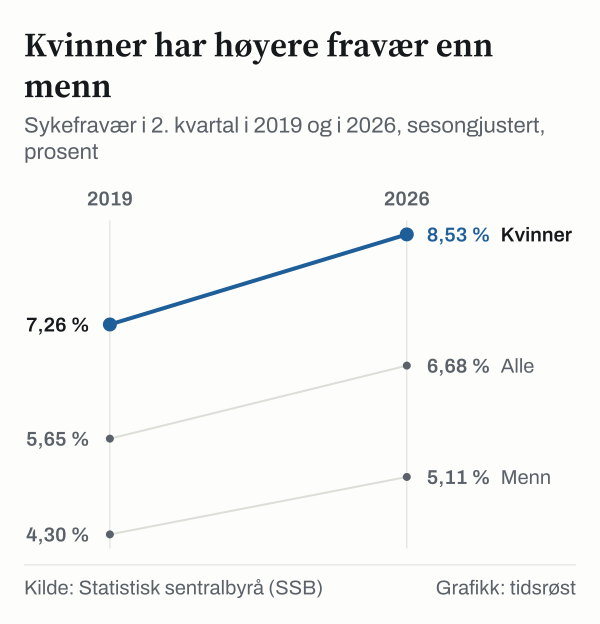

Sykefraværet blant norske lønnstakere var 6,68 prosent i 2. kvartal 2026, sesongjustert, viser statistikken Statistisk sentralbyrå (SSB) og Nav la fram 3. september 2026. Kvinner hadde et fravær på 8,53 prosent og menn 5,11 prosent, en forskjell på 3,42 prosentpoeng. Høyest var fraværet i helse- og sosialtjenester med 9,61 prosent. Samtidig var 31 prosent av de legemeldte sykefraværene gradert, den høyeste andelen Nav har målt.

## Kvinner og menn

Kvinner har hatt høyere sykefravær enn menn i 2. kvartal hvert år siden 2000. I 2. kvartal 2019 var fraværet 7,26 prosent blant kvinner og 4,30 prosent blant menn. I 2. kvartal 2026 var tallene 8,53 og 5,11 prosent.

*Egenmeldt og legemeldt sykefravær i 2. kvartal, sesongjustert. Kilde: SSB, tabell 12439.*

## Næringene

Blant næringene i SSBs oversikt var sykefraværet høyest i helse- og sosialtjenester (9,61 prosent), transport og lagring (7,39 prosent) og forretningsmessig tjenesteyting (7,06 prosent). Lavest var det i informasjon og kommunikasjon med 4,15 prosent.

![Stolpediagram over Høyest fravær i helse- og sosialtjenester: Sykefravær: Jordbruk, skogbruk og fiske: 5,13 %, Bergverk og utvinning: 4,75 %, Industri: 5,94 %, Kraft, vann og renovasjon: 5,41 %, Bygg og anlegg: 6,41 %, Varehandel: 6,27 %, Transport og lagring: 7,39 %, Overnatting og servering: 6,44 %, Informasjon og kommunikasjon: 4,15 %, Finans og forsikring: 4,59 %, Eiendom, faglig og teknisk: 4,71 %, Forretningsmessig tjenesteyting: 7,06 %, Offentlig administrasjon: 5,68 %, Undervisning: 6,66 %, Helse og sosial: 9,61 %, Personlig tjenesteyting: 6,10 %, Alle næringer: 6,68 %.](./graf-3.svg)
*Egenmeldt og legemeldt sykefravær etter næring (SN2007), 2. kvartal 2026, sesongjustert. Den stiplede linjen viser alle næringer. Kilde: SSB, tabell 13935.*

Fra 2. kvartal 2025 til 2. kvartal 2026 økte sykefraværsprosenten med 2,0 prosent for alle næringer samlet. Økningen var 3,3 prosent i industrien, 3,1 prosent i undervisning, 2,2 prosent både i helse- og sosialtjenester og i transport og lagring, 1,5 prosent i informasjon og kommunikasjon og 0,9 prosent i forretningsmessig tjenesteyting.

## Sykefraværet over tid

Målt i 2. kvartal hvert år lå det sesongjusterte sykefraværet på 7,74 prosent i 2003, det høyeste i perioden fra 2000. Deretter gikk det ned til 5,53 prosent i 2018. Siden har det steget, til en topp på 6,89 prosent i 2024. I 2025 var fraværet 6,55 prosent. Ifølge Nav har sykefraværet økt noe i første halvår 2026 etter nedgangen i 2025.

*Egenmeldt og legemeldt sykefravær i 2. kvartal hvert år, sesongjustert. Kilde: SSB, tabell 12439.*

## Graderte sykmeldinger

Ved gradert sykmelding er den sykmeldte delvis i arbeid. Ifølge Nav var 31 prosent av de legemeldte sykefraværene i 2. kvartal 2026 gradert, opp fra knapt 29 prosent ett år tidligere.

## Sykepenger og forslag i statsbudsjettet for 2027

Sykepengeordningen i folketrygden gir arbeidstakere full lønnskompensasjon opp til 6 G ved sykdom. I regjeringens budsjettforslag for 2027 er utgiftene til sykepenger anslått til om lag 72 milliarder kroner.

Ifølge regjeringens pressemelding foreslås det 78 millioner kroner i økte bevilgninger i 2027: 20 millioner kroner til samarbeid mellom Nav og helsetjenesten, 30 millioner kroner til beslutningsstøtte for fastleger og andre sykmeldere og 27,8 millioner kroner til informasjonsutveksling og en ny digital sykmeldingsløsning.

## Hva tallene ikke viser

Sykefraværsprosenten måler hvor stor andel av de avtalte dagsverkene som går tapt på grunn av sykdom. Den viser ikke hvor mange personer som er sykmeldt. Av fraværet på 6,68 prosent i 2. kvartal 2026 var 5,67 prosentpoeng legemeldt og 1,02 prosentpoeng egenmeldt.

Tallene i artikkelen er sesongjustert, slik at kvartaler kan sammenlignes uten de vanlige sesongsvingningene. SSB publiserer også en serie som i tillegg er justert for influensa.

## Kilder

- [SSB: Sykefravær, 2. kvartal 2026](https://www.ssb.no/arbeid-og-lonn/arbeidsmiljo-sykefravaer-og-arbeidskonflikter/statistikk/sykefravaer)
- [SSB: Svak økning i sykefraværet (3. september 2026)](https://www.ssb.no/arbeid-og-lonn/arbeidsmiljo-sykefravaer-og-arbeidskonflikter/statistikk/sykefravaer/artikler/svak-okning-i-sykefravaeret-2026-09-03)
- [SSB Statistikkbanken, tabell 12439](https://www.ssb.no/statbank/table/12439)
- [SSB Statistikkbanken, tabell 13935](https://www.ssb.no/statbank/table/13935)
- [Nav: Økt sykefravær i første halvår](https://www.nav.no/no/nav-og-samfunn/statistikk/sykefravar-statistikk/nyheter/okt-sykefravaer-i-forste-halvar)
- [Nav: Sykepenger til arbeidstakere](https://www.nav.no/sykepenger)
- [Regjeringen: Folketrygdens utgifter (7. oktober 2026)](https://www.regjeringen.no/no/aktuelt/folketrygdens-utgifter/id3176081/)
- [Regjeringen: 78 millioner kroner for å få ned sykefraværet (7. oktober 2026)](https://www.regjeringen.no/no/aktuelt/78-millioner-kroner-for-fa-ned-sykefravaret/id3176573/)
