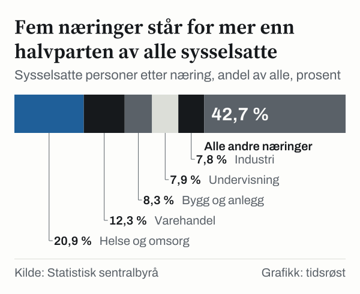

20,9 prosent. Så stor andel av alle sysselsatte i Norge jobbet innen helse og omsorg i 2025. I 1970 var andelen 6,9 prosent.

Det er ett tall fra en lang rekke. Statistisk sentralbyrå (SSB) teller hvor mange som har jobb i hver næring, og regnskapet går tilbake til året 1970. Over de femtifem årene har næringene byttet plass. Blant næringene i analysen var industrien størst i 1970 med 22,0 prosent av de sysselsatte, og jordbruk og skogbruk kom på tredjeplass. I 2025 var industriens andel 7,8 prosent.

Analysen går gjennom tallene i tre stopp, i 1970, i 1995 og i 2025, og stiller tre spørsmål. Hvilke næringer vokste, hvilke krympet, og hvor stor del av veksten kom fra hvilken?

## Hva som telles, og hva som ikke gjør det

Tallene kommer fra SSBs nasjonalregnskap og viser sysselsatte personer, lønnstakere og selvstendige til sammen. Tallene viser sysselsatte etter næring.

Det er personer som telles, ikke årsverk. En deltidsansatt teller like mye som en heltidsansatt. Det betyr noe, og vi kommer tilbake til hvor mye. Næringene er SSBs egne grupper, og vi har valgt ut dem som er størst, eller som har endret seg mest.

Samlet sett hadde Norge 1622,5 tusen sysselsatte i 1970. I 1995 var tallet 2111,1 tusen, og i 2025 var det 3013,4 tusen. Antallet sysselsatte økte i begge periodene, først i 1970–1995 og deretter i 1995–2025. Totalt ble det 1390,9 tusen flere i 1970–2025, en økning på 85,7 prosent.

## Året 1970: industri, varehandel og jordbruk størst

Første stopp er året 1970. Jordbruk og skogbruk hadde da 188,1 tusen sysselsatte, og industrien hadde 357,4 tusen. Sammen sto de to næringene for 11,6 prosent og 22,0 prosent av alle sysselsatte. Varehandel kom nær etter med 14,4 prosent.

Langt mindre var helse og omsorg. Næringen hadde 112,5 tusen sysselsatte, og undervisning hadde 90,2 tusen. Faglig tjenesteyting, som regnskap, juss og teknisk rådgivning, var nesten fraværende med 25,3 tusen sysselsatte. Forretningstjenester som utleie og renhold hadde 12,8 tusen.

Av de tolv næringene som er med i analysen, var industri, varehandel og jordbruk og skogbruk størst i 1970. Både industri og jordbruk og skogbruk hadde færre sysselsatte i 2025 enn i 1970.

Olje og gass er ikke med i tallene for året 1970. Næringen har ingen sysselsatte i regnskapet det året og kommer inn senere. Utenriks sjøfart hadde derimot 54,1 tusen sysselsatte.

## 1970–1995: færre i jordbruk og industri, flere i helse og omsorg

*Andel av alle sysselsatte personer, prosent. Kilde: Statistisk sentralbyrå.*

Industrien hadde 85,9 tusen færre sysselsatte, jordbruk og skogbruk hadde 100,7 tusen færre, og helse og omsorg hadde 252,3 tusen flere. Ved slutten av perioden, i 1995, var andelen i helse og omsorg 17,3 prosent, mot 12,9 prosent i industrien.

I 1995 var helse og omsorg allerede større enn både industrien og varehandel, med 364,8 tusen sysselsatte mot 271,5 tusen og 291,1 tusen. Helse og omsorg hadde færre sysselsatte enn industrien i 1970, men flere i 1995.

Bygg og anlegg hadde 113,3 tusen sysselsatte i 1970. I 1995 var tallet 101,4 tusen, altså færre. Andelen falt fra 7,0 prosent til 4,8 prosent. Tallene sier ikke hvorfor, og de sier heller ikke noe om hvordan antallet svingte mellom de to årene.

Undervisning og informasjon og kommunikasjon hadde flere sysselsatte i 1995 enn i 1970. Undervisning økte fra 90,2 tusen til 158,4 tusen sysselsatte, og andelen steg fra 5,6 prosent til 7,5 prosent. Informasjon og kommunikasjon gikk fra 38,3 tusen til 66,9 tusen.

Faglig tjenesteyting og forretningstjenester vokste fra små tall. Faglig tjenesteyting gikk fra 25,3 tusen til 69,3 tusen, og forretningstjenester fra 12,8 tusen til 47,6 tusen. De to næringene var fortsatt små i forhold til helse og omsorg, med andeler på 3,3 prosent og 2,3 prosent.

## 1995–2025: ulik vekst i de utvalgte næringene

De siste tretti årene ser annerledes ut. Antallet sysselsatte økte med 42,7 prosent, fra 2111,1 tusen til 3013,4 tusen. Men veksten fordelte seg ujevnt.

*Endring i antall sysselsatte personer over tretti år, prosent. Kilde: Statistisk sentralbyrå.*

Blant de ti næringene i diagrammet hadde forretningstjenester, bygg og anlegg og faglig tjenesteyting høyest prosentvis vekst, med 174,8 prosent, 145,5 prosent og 137,1 prosent. Alle tre vokste mer enn dobbelt så mye som antallet sysselsatte totalt. Helse og omsorg økte med 73,0 prosent, og det var mer enn totalen, men mindre enn de tre.

Innen helse og omsorg var det 364,8 tusen sysselsatte i 1995. I 2025 var tallet 631,2 tusen. Økningen i antall var større i 1995–2025 enn i 1970–1995. Økningen var 266,4 tusen mot 252,3 tusen.

Varehandel er et eksempel på at antall og andel kan gå i hver sin retning. Næringen økte fra 291,1 tusen til 372,1 tusen sysselsatte, men andelen falt fra 13,8 prosent til 12,3 prosent. Totalen vokste raskere enn varehandel. Undervisning økte i samme periode med 51,1 prosent, fra 158,4 tusen til 239,3 tusen.

Bygg og anlegg hadde 101,4 tusen sysselsatte i 1995. I 2025 var tallet 248,9 tusen. Antallet sysselsatte i bygg og anlegg mer enn doblet seg. Andelen gikk fra 4,8 prosent til 8,3 prosent, over nivået i 1970.

Informasjon og kommunikasjon og overnatting og servering økte omtrent like mye. Den første gikk fra 66,9 tusen til 118,3 tusen, og den andre fra 68,3 tusen til 118,5 tusen. Begge har altså en andel på rundt fire prosent av de sysselsatte, med 3,9 prosent og 3,9 prosent.

To næringer som ligger utenfor det SSB kaller Fastlands-Norge, har gått hver sin vei. Olje og gass med tilknyttede tjenester gikk fra 24,0 tusen til 68,1 tusen sysselsatte. Utenriks sjøfart falt med 86,9 prosent, fra 39,6 tusen til 5,2 tusen. Begge er små i forhold til helse og omsorg, som hadde 631,2 tusen sysselsatte i 2025.

På den andre siden gikk industrien videre ned. Industrien falt med 13,6 prosent og jordbruk og skogbruk med 46,1 prosent. Falt industrien i 1970–1995 med 85,9 tusen sysselsatte, falt den i 1995–2025 med 36,8 tusen. Nedgangen i antall var mindre i 1995–2025 enn i 1970–1995, selv om andelen fortsatte å falle.

## Hvor veksten kom fra

Når antallet økte med 1390,9 tusen i 1970–2025, hvem sto for økningen? Svaret avhenger av hva som regnes som en næring og hva som havner i restposten.

*Endring i antall sysselsatte personer etter næring. Kilde: Statistisk sentralbyrå.*

Helse og omsorg sto for 518,7 tusen av økningen på 1390,9 tusen, en andel på over en tredjedel. Faglig tjenesteyting la til 139,0 tusen, forretningstjenester 118,0 tusen, varehandel 137,7 tusen og bygg og anlegg 135,6 tusen. I den andre retningen gikk industrien ned med 122,7 tusen sysselsatte og jordbruk og skogbruk med 141,0 tusen.

Resten, alle næringene som ikke er regnet opp her, står for 605,6 tusen. Der ligger blant annet undervisning med 149,1 tusen, informasjon og kommunikasjon med 80,0 tusen og overnatting og servering med 80,8 tusen. Der ligger også olje og gass med tilknyttede tjenester, som hadde 68,1 tusen sysselsatte i 2025, og utenriks sjøfart, som gikk ned med 48,9 tusen.

*Sysselsatte personer etter næring, andel av alle, prosent. Kilde: Statistisk sentralbyrå.*

Helse og omsorg, varehandel, bygg og anlegg, undervisning og industri hadde andeler på henholdsvis 20,9 prosent, 12,3 prosent, 8,3 prosent, 7,9 prosent og 7,8 prosent, mens alle andre næringer til sammen hadde 42,7 prosent.

## Timer i stedet for personer

Alt dette teller personer. Telles timer i stedet, blir bildet litt annerledes. I 2025 utgjorde helse og omsorg 806,5 millioner av de 4172,9 millionene utførte timeverk i økonomien. Det gir en andel på 19,3 prosent av timene, mot 20,9 prosent av personene.

Næringens andel av timene er lavere enn andelen av personene. Tallene viser ikke hvorfor, og de sier ikke noe om innsats eller verdi. De beskriver bare hvordan arbeidstiden fordeler seg.

Personer og timer gir ulike størrelser. Næringen er like stor som tallene over viser når vi teller personer, men litt mindre når vi teller timer. Begge tall er riktige, og de svarer på ulike spørsmål.

## Hva tallene ikke forteller

Analysen viser hvem som har jobb i hvilken næring, ikke hvorfor fordelingen har endret seg. Et årstall i en tabell er en måling og ikke en forklaring. Flere forhold kan ligge bak, men ingen av dem er undersøkt her.

Alle tall gjelder slik tabellen så ut 23. oktober 2026, og de er ikke kontrollert mot andre kilder enn SSBs egen tabell. Analysen gir heller ingen anslag for årene som kommer.

Tre stopp gir også et grovt bilde. Vi har ikke sett på hvordan antallet endret seg mellom stoppene, og vi har ikke delt opp næringene i undergrupper. I både 1970–1995 og 1995–2025 kan antallet ha gått opp og ned flere ganger uten at det vises her. Næringsgrupperingen er dessuten SSBs, og en annen gruppering ville gitt andre tall for hver enkelt næring.

## Slik regnet vi

Den som vil sjekke tallene, finner dem i SSBs statistikkbank ved å velge næring, statistikkvariabel og år. Vi har brukt næringskodene slik tabellen oppgir dem, og vi har ikke slått sammen næringer utover det som står i tabellen, med unntak av gruppene «alle andre næringer» og samlet endring.

Antall sysselsatte personer, lønnstakere og selvstendige, er hentet fra SSBs tabell over lønn, sysselsetting og produktivitet etter næring, for tre ulike år (i 1970, i 1995 og i 2025). Utførte timeverk for helse og omsorg og for økonomien totalt er hentet fra samme tabell for året 2025. Tallene ble hentet 23. oktober 2026.

Andelene er antall sysselsatte i en næring delt på alle sysselsatte i samme år. Endringene i antall gjelder 1970–2025 eller 1995–2025, og prosentendringene gjelder 1995–2025. Restposten i fossefallsdiagrammet er den samlede endringen minus summen av de næringene som er regnet opp. Andelen som kalles alle andre næringer, er på samme måte det som er igjen etter de fem største.

## Kilder

- [SSB: Lønn, sysselsetting og produktivitet, etter næring](https://www.ssb.no/statbank/table/09174)
- [SSB: Nasjonalregnskap](https://www.ssb.no/nasjonalregnskap-og-konjunkturer/nasjonalregnskap/statistikk/nasjonalregnskap)
