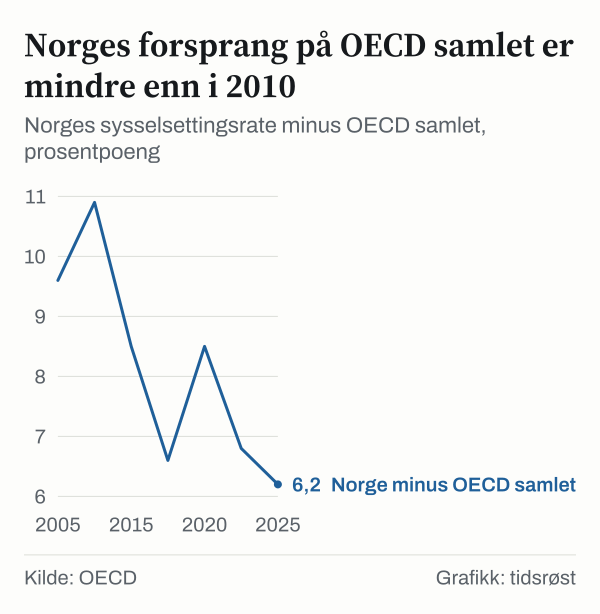

Norge er nummer ni av trettiåtte OECD-land på sysselsettingsraten i 2025. Av befolkningen mellom femten og sekstifire år var 76,6 prosent i jobb. I 2005 var Norge nummer fire, med 74,8 prosent.

Det betyr at en større andel av befolkningen er i jobb enn i 2005. Raten økte med 1,8 prosentpoeng. Likevel har Norge sunket i rangeringen, mens mange andre land har økt mer. OECD samlet gikk fra 65,2 prosent til 70,4 prosent, en økning på 5,2 prosentpoeng.

Bare fire av de andre trettisju landene økte raten mindre enn Norge: Island, Danmark, USA og Costa Rica, der raten falt. Rangeringen viser at feltet rundt Norge har flyttet seg. Da vi stilte tallene side om side, viste det seg også at fallet ikke fordeler seg jevnt på aldersgrupper. Denne analysen ser først på hvem som passerte Norge, deretter på hvor i befolkningen forspranget har blitt borte, og til slutt på hva rangeringen ikke kan fortelle.

## Fra fjerdeplass til niendeplass med høyere sysselsetting

Sysselsettingsraten er andelen av befolkningen i alderen femten til sekstifire år som har arbeid. OECD publiserer tallene for medlemslandene, og her har vi brukt dagens trettiåtte medlemmer i begge årene. Island var på førsteplass både i 2005 og i 2025, med 82,8 prosent og 84,5 prosent.

I 2025 hadde Island 84,5 prosent, Nederland 82,3 prosent, Japan 80,0 prosent og Sveits 79,9 prosent. I 2005 var rekkefølgen i toppen Island, Sveits, Danmark og Norge. I 2025 var den Island, Nederland, Japan, Sveits, New Zealand, Australia, Tyskland, Danmark og Norge. Norge har altså fått fem land foran seg som ikke var der i 2005, selv om Norges egen rate har økt.

Norges rate var mellom 74,7 prosent og 75,3 prosent i 2005, i 2010, i 2015, i 2019 og i 2020. I 2024 var den 77,1 prosent, 2,4 prosentpoeng høyere enn i 2020. I 2025 var den 76,6 prosent, 0,5 prosentpoeng lavere enn året før.

## Hvem som passerte Norge

To land skiller seg ut. Nederland gikk fra ellevte til andre plass, fra 70,8 prosent til 82,3 prosent. Japan gikk fra trettende til tredje plass, fra 69,3 prosent til 80,0 prosent. Tyskland gikk fra attende til syvende plass.

Sterkest økning av alle hadde land som lå langt nede i 2005. Polen gikk fra trettisjuende til tjueførste plass, med en økning på 19,8 prosentpoeng, og Ungarn fra trettifemte til femtende plass, med en økning på 18,2 prosentpoeng.

Danmark og Sverige beveget seg motsatt vei i rangeringen, selv om begge økte raten. Danmark gikk fra tredje til åttende plass, selv om raten økte. Sverige gikk fra sjette til tiende plass, med en økning på 2,4 prosentpoeng. Sveits økte med 2,7 prosentpoeng og gikk fra andre til fjerde plass.

*Sysselsatte i prosent av befolkningen mellom femten og sekstifire år, i 2005 og i 2025. Kilde: OECD.*

Mønsteret er det samme i flere land som lå høyt i 2005. Storbritannia gikk fra syvende til tolvte plass, Canada fra åttende til attende og USA fra tiende til tjuefemte. Rekkefølgen sier ikke noe om hvorfor, bare at andre land har økt raten mer enn disse.

## Et tett midtfelt der små forskjeller gir nye plasser

I 2025 var seks land samlet i et bånd fra 76,4 prosent til 77,2 prosent: New Zealand, Australia og Tyskland med 77,2 prosent, Danmark med 77,0 prosent, Norge med 76,6 prosent og Sverige med 76,4 prosent. Norge lå 0,6 prosentpoeng under New Zealand og Tyskland og 0,2 prosentpoeng over Sverige.

Island lå nesten åtte prosentpoeng over Norge. I tallene er det altså et lite felt i midten der noen tideler avgjør plasseringen.

*Sysselsatte i prosent av befolkningen mellom femten og sekstifire år, i 2025, de tjue høyeste landene; stiplet linje er OECD samlet. Kilde: OECD.*

Det betyr at endringen fra fjerde til niende plass ikke kan leses som fem like store steg. Mellom plass fem og ti i 2025 ligger alle landene i et smalt bånd, så en liten endring i et enkelt land kan flytte flere plasser.

## Hvor forspranget forsvant: tre aldersgrupper

For å se hvor i befolkningen forskjellen oppstår, har vi delt raten i tre aldersgrupper. I aldersgruppen fra tjuefem til femtifire år var Norges rate 83,2 prosent i 2005 og 83,3 prosent i 2025, praktisk talt uendret. OECD samlet gikk i samme gruppe fra 75,7 prosent til 80,2 prosent, en økning på 4,5 prosentpoeng. Norge falt fra sjette til tjueandre plass. Slovenia hadde den høyeste raten i gruppen i 2025, med 89,6 prosent.

Blant de eldste, fra femtifem til sekstifire år, økte Norges rate fra 65,5 prosent til 72,6 prosent, en økning på 7,1 prosentpoeng. OECD samlet økte mer, fra 51,7 prosent til 65,2 prosent. Norge gikk fra fjerde til tolvte plass. Sverige var på tredjeplass i denne gruppen i 2025, med 78,4 prosent, 5,8 prosentpoeng over Norge.

Den yngste gruppen, fra femten til tjuefire år, gikk motsatt vei i rangeringen. Norges rate økte fra 53,4 prosent til 58,3 prosent, en økning på 4,9 prosentpoeng, mens OECD samlet bare økte fra 42,7 prosent til 43,0 prosent, en økning på 0,3 prosentpoeng. Norge gikk fra ellevte til sjette plass.

Til sammen gir dette et bilde der Norges forsprang på OECD samlet for aldersgruppen fra femten til sekstifire år har blitt mindre: forskjellen mellom Norge og OECD samlet var 9,6 prosentpoeng i 2005. I 2025 var den 6,2 prosentpoeng. Blant årene vi har regnet ut, var forskjellen størst i 2010, med 10,9 prosentpoeng. Vi har ikke regnet ut årene imellom. De tre gruppene sier tre ulike ting. Blant de yngste og de eldste har Norge økt, men blant dem mellom tjuefem og femtifire år, har raten stått stille mens OECD samlet har økt. Vi har ikke tall som forklarer hvorfor den midterste aldersgruppen står stille, og vi vil ikke gjette på en årsak.

*Norges sysselsettingsrate minus OECD samlet, prosentpoeng. Kilde: OECD.*

## Fire nordiske veier

Blant de nordiske landene er utviklingen ikke lik. Island lå øverst både i 2005 og i 2025 og økte med 1,7 prosentpoeng. Finland økte mest av de nordiske, med 3,6 prosentpoeng fra 68,5 prosent til 72,1 prosent, men gikk likevel fra fjortende til tjuetredje plass mens mange land økte mer. Sammenligner vi med nivået i 2019, var raten i Finland og Sverige lavere i 2025: Finland gikk fra 73,1 prosent til 72,1 prosent og Sverige fra 77,1 prosent til 76,4 prosent. I Danmark og Norge var den høyere, med 75,2 prosent i 2019 og 77,0 prosent i 2025 for Danmark og 75,3 prosent og 76,6 prosent for Norge. Norge og Danmark lå på nesten samme nivå i 2019, med 75,3 prosent og 75,2 prosent, og begge lå høyere i 2025. Danmark, Sverige og Norge endte tett, mellom 76,4 prosent og 77,0 prosent.

![Små linjediagrammer over De nordiske landene har tatt ulike veier siden 2005: Norge: 74,8 % i 2005, 75,3 % i 2010, 74,8 % i 2015, 75,3 % i 2019, 74,7 % i 2020, 77,1 % i 2024, 76,6 % i 2025; Sverige: 74,0 % i 2005, 72,1 % i 2010, 75,5 % i 2015, 77,1 % i 2019, 75,5 % i 2020, 76,7 % i 2024, 76,4 % i 2025; Danmark: 76,1 % i 2005, 71,9 % i 2010, 72,1 % i 2015, 75,2 % i 2019, 74,5 % i 2020, 77,3 % i 2024, 77,0 % i 2025; Finland: 68,5 % i 2005, 68,3 % i 2010, 68,7 % i 2015, 73,1 % i 2019, 72,2 % i 2020, 72,7 % i 2024, 72,1 % i 2025; Island: 82,8 % i 2005, 77,0 % i 2010, 82,2 % i 2015, 81,5 % i 2019, 77,9 % i 2020, 85,3 % i 2024, 84,5 % i 2025.](./graf-4.svg)
*Sysselsatte i prosent av befolkningen mellom femten og sekstifire år. Kilde: OECD.*

Danmarks rate var lavere i 2010 og lavere i 2015 enn i 2005, og Sveriges rate var også lavere i 2010 enn i 2005. Norges rate var omtrent den samme i alle tre årene vi har hentet.

## Andre måter å lese rangeringen på

En rangering er relativ. Når et land går ned på listen, kan det skyldes at landet selv har gjort det dårligere, at andre har gjort det bedre, eller begge deler. I Norges tilfelle viser tallene det andre: raten økte, men OECD samlet økte mer. Norges rate var allerede 9,6 prosentpoeng over OECD samlet i 2005.

En annen lesning er at rangeringen blander ulike aldersstrukturer. En sysselsettingsrate for femten til sekstifire år avhenger av hvor mange som er i hver aldersgruppe og hvor mange som er under utdanning. Gruppetallene over er et forsøk på å skille dette, men de fjerner ikke effekten helt.

Rangering etter nivå og rangering etter endring gir dessuten ulike svar. Etter nivå i 2025 er Norge nummer ni. Etter økningen siden 2005 er Norge nummer trettifire av trettiåtte, og bare fire land økte mindre. Det første svaret forteller hvor Norge står nå, det andre hvor mye som er skjedd på tjue år, og begge er riktige.

## Det målingen ikke dekker

Sysselsettingsraten teller personer, ikke arbeidstid. Tallet sier ingenting om hvor mange timer som arbeides. Rangeringen sier derfor ikke at nordmenn arbeider mindre eller mer enn andre, bare at en gitt andel av befolkningen har arbeid.

Tallene har en måleusikkerhet som vi ikke kjenner størrelsen på her. Forskjeller på noen få tideler, som mellom Norge og Sverige i 2025, kan ligge innenfor det man kan regne som støy. Medlemskretsen i OECD har dessuten endret seg siden 2005. Vi rangerer dagens trettiåtte medlemmer i begge årene, så et land som ble medlem senere er likevel med i tallene fra året 2005. Det gjør sammenligningen konsistent, men en rangering av medlemmene slik de var i 2005 kunne gitt andre plasseringer. Tall fra arbeidskraftundersøkelser kan også revideres etter at de er publisert, og vi har brukt tallene slik de sto i OECDs database da vi hentet dem. Vi ser heller ikke på årsaker. Rangeringene sier ikke hvorfor de ulike landene har havnet der de har havnet, og vi vil ikke tolke dem som uttrykk for noe annet enn hva som er målt.

## Slik regnet vi

Alle tall er sysselsettingsraten, altså sysselsatte i prosent av befolkningen, fra OECDs tabell over sysselsetting og arbeidsledighet etter aldersgruppe. Vi har brukt alle personer samlet og aldersgruppene femten til sekstifire, tjuefem til femtifire, femtifem til sekstifire og femten til tjuefire år. Sammenligningen gjelder året 2005 og året 2025, og enkelte mellomår i grafene. Rangeringene er laget ved å sortere dagens trettiåtte OECD-land etter verdi. Forskjeller i prosentpoeng er enkle differanser mellom to av verdiene. OECD samlet er OECDs egen sammenstilling og er ikke et land i rangeringen. Når to land har samme verdi i det viste tallet, bruker vi OECDs uavrundede verdier til å avgjøre rekkefølgen. Differanser i prosentpoeng er regnet ut fra de uavrundede verdiene, så en differanse kan avvike med en tidel fra differansen mellom de viste, avrundede tallene. Alle tall er hentet 23. oktober 2026.

## Kilder

- [OECD: Employment and unemployment by five-year age group and sex, indicators](https://sdmx.oecd.org/public/rest/dataflow/OECD.ELS.SAE/DSD_LFS@DF_LFS_INDIC/1.1)
