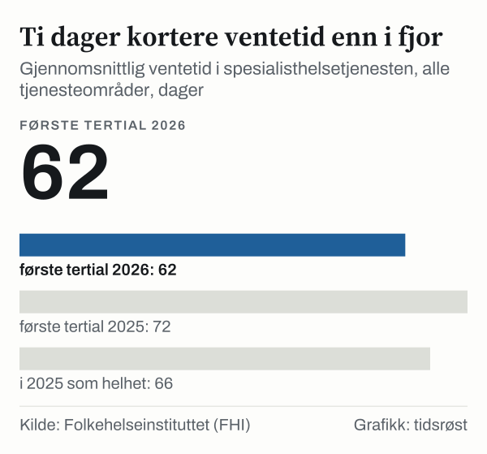

Pasienter som ble henvist til spesialisthelsetjenesten i årets fire første måneder (1. tertial 2026), ventet i gjennomsnitt 62 dager før helsehjelpen startet, viser statistikk fra Norsk pasientregister som Folkehelseinstituttet (FHI) la fram 23. juni 2026. Det er ti dager kortere enn i samme periode i 2025. Regjeringen har som mål at pasienter på sikt normalt skal ha fått eller være i gang med behandling innen 60 dager.

## Hva målene er

Regjeringen la fram et nytt ventetidsmål 19. juni 2026: På sikt skal pasienter normalt ha fått behandling eller være i gang med behandling innen 60 dager, med mindre medisinske grunner tilsier noe annet eller pasienten selv ønsker å vente.

I tillegg har Helse- og omsorgsdepartementet i oppdragsdokumentene til de regionale helseforetakene satt langsiktige mål for den gjennomsnittlige ventetiden i hvert tjenesteområde: under 50 dager i somatikken, under 40 dager i psykisk helsevern for voksne, under 35 dager i psykisk helsevern for barn og unge og under 30 dager i tverrfaglig spesialisert rusbehandling (TSB).

## Hvor ventetiden er nå

I 1. tertial 2026 var ventetiden 64 dager i somatikken (75 dager i 1. tertial 2025), 43 dager i psykisk helsevern for voksne (51), 41 dager i psykisk helsevern for barn og unge (46) og 27 dager i TSB (28). Ifølge FHI ble ventetiden kortere i alle tjenesteområder.

*Gjennomsnittlig ventetid i 1. tertial 2025 og 2026, dager. De stiplede strekene viser de langsiktige målene i departementets oppdragsdokumenter. Kilde: FHI og Helse- og omsorgsdepartementet.*

Ved utgangen av desember 2025 var den gjennomsnittlige ventetiden for påbegynt helsehjelp 57 dager, tolv dager kortere enn i desember 2024. Rundt 225 900 pasienter ventet ved utgangen av desember 2025.

| Måling (hele landet) | Desember 2024 | Desember 2025 |
|---|---|---|
| Ventetid påbegynt helsehjelp | 69 dager | 57 dager |
| Andel fristbrudd, ventende | 7,7 % | 4,6 % |
| Andel fristbrudd, påbegynt helsehjelp | 8,3 % | 6,0 % |

*Kilde: Helse- og omsorgsdepartementet, 15. januar 2026.*

Andelen fristbrudd blant ventende somatiske pasienter gikk ned fra 10,1 prosent ved utgangen av 2023 til 7,7 prosent ved utgangen av 2024, ifølge Helsedirektoratet.

## Utviklingen

Om lag 2,9 millioner pasienter fikk helsehjelp i spesialisthelsetjenesten i 2025. Den gjennomsnittlige ventetiden for alle tjenesteområder var 73 dager i 2023, 74 dager i 2024 og 66 dager i 2025. I somatikken var årsgjennomsnittet 75 dager i 2023, 77 dager i 2024 og 68 dager i 2025.

*Gjennomsnittlig ventetid, alle tjenesteområder, dager. Kilde: FHI.*

| Tjenesteområde | 2023 | 2024 | 2025 |
|---|---:|---:|---:|
| Somatikk | 75 | 77 | 68 |
| Psykisk helsevern for voksne | 54 | 55 | 46 |
| Psykisk helsevern for barn og unge | 55 | 52 | 41 |
| Rusbehandling (TSB) | 33 | 30 | 26 |

*Gjennomsnittlig ventetid til påbegynt helsehjelp, helår, dager. Kilde: FHI.*

## Slik måles ventetiden

Hovedindikatoren måler antall kalenderdager fra spesialisthelsetjenesten mottar en henvisning til utredning eller behandling starter. Akuttinnleggelser og øyeblikkelig hjelp holdes utenfor. FHI publiserer reviderte tall hvert tertial og for hele året. Tallene varierer gjennom året i takt med ferieavvikling, så et tertial bør sammenlignes med samme tertial året før.

## Kilder

- [FHI: Ventetider og aktivitet i spesialisthelsetjenesten 1. tertial 2026](https://www.fhi.no/nyheter/2026/ventetider-og-aktivitet-i-spesialisthelsetjenesten-1.-tertial-2026)
- [FHI: Ventetider og aktivitet i spesialisthelsetjenesten i 2025](https://www.fhi.no/nyheter/2026/ventetider-og-aktivitet-i-spesialisthelsetjenesten-i-2025)
- [FHI: Aktivitet og ventetider i spesialisthelsetjenesten 2024](https://www.fhi.no/nyheter/2025/aktivitet-og-ventetider-i-spesialisthelsetjenesten-2024/)
- [FHI: Statistikk om ventetider og pasientrettigheter](https://www.fhi.no/he/npr/statistikk-npr/ventetider-og-pasientrettigheter/)
- [Helsedirektoratet: Sykehusopphold – ventetid påbegynt helsehjelp](https://www.helsedirektoratet.no/statistikk/kvalitetsindikatorer/sykehusopphold/gjennomsnittlig-ventetid-i-somatisk-helsetjeneste)
- [Helsedirektoratet: Sykehusopphold – fristbrudd for ventende pasienter](https://www.helsedirektoratet.no/statistikk/kvalitetsindikatorer/sykehusopphold/fristbrudd-for-pasienter-p%C3%A5-venteliste-i-somatisk-helsetjeneste)
- [Helsedirektoratet: Psykisk helsevern for voksne – ventetid påbegynt helsehjelp](https://www.helsedirektoratet.no/statistikk/kvalitetsindikatorer/psykisk-helse-for-voksne/gjennomsnittlig-ventetid-for-voksne-i-psykisk-helsevern)
- [Helsedirektoratet: Psykisk helsevern for barn og unge – ventetid påbegynt helsehjelp](https://www.helsedirektoratet.no/statistikk/kvalitetsindikatorer/psykisk-helse-for-barn-og-unge/gjennomsnittlig-ventetid-for-barn-og-unge-i-psykisk-helsevern)
- [Helsedirektoratet: Rusbehandling – ventetid påbegynt helsehjelp](https://www.helsedirektoratet.no/statistikk/kvalitetsindikatorer/rusbehandling/gjennomsnittlig-ventetid-for-pasienter-i-tverrfaglig-spesialisert-rusbehandling)
- [Regjeringen: Ventetidene ned tolv dager (15.01.2026)](https://www.regjeringen.no/no/aktuelt/ventetidene-ned-12-dager/id3146206/)
- [Regjeringen: Fakta om ventetider](https://www.regjeringen.no/no/tema/helse-og-omsorg/sykehus/innsikt/fakta-om-ventetider/id3044744/)
- [Regjeringen: Oppdragsdokument 2025 Helse Sør-Øst RHF (langsiktige ventetidsmål)](https://www.regjeringen.no/contentassets/bd8a11644b744dec8a8dc452794000e4/oppdragsdokument-helse-sor-ost-rhf-2025.pdf)
