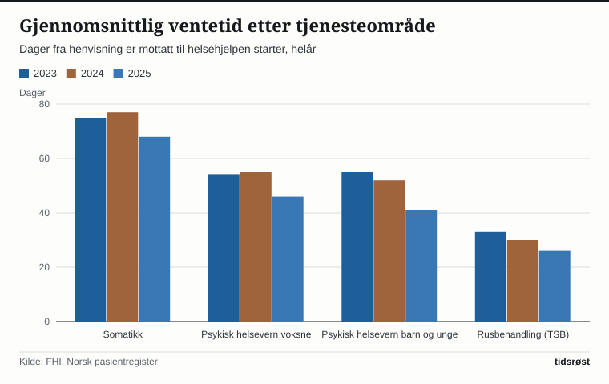

I årets fire første måneder (1. tertial 2026) ventet pasienter som ble henvist til spesialisthelsetjenesten, i gjennomsnitt 62 dager før helsehjelpen startet, viser statistikk fra Norsk pasientregister som Folkehelseinstituttet (FHI) la fram 23. juni 2026. Det er hele ti dager kortere enn i samme periode i 2025, da ventetiden var 72 dager.

Ser man på kalenderåret 2025 under ett, gikk den gjennomsnittlige ventetiden ned fra 74 dager i 2024 til 66 dager i 2025. Ventetidene har gått ned i samtlige fire hovedområder i spesialisthelsetjenesten, og rusbehandlingen innfrir allerede de langsiktige målene i *Nasjonal helse- og samhandlingsplan 2024–2027*.

## Slik måles ventetiden i sykehusene

Den offisielle hovedindikatoren måler antall kalenderdager fra spesialisthelsetjenesten mottar en henvisning til utredning eller behandling faktisk starter. Akuttinnleggelser og øyeblikkelig hjelp holdes utenfor, ettersom slike pasienter tas imot umiddelbart. FHI publiserer reviderte tall hvert tertial og for hele året, i tillegg til foreløpige månedstall innen den 15. i måneden etter.

Tallene varierer naturlig gjennom året i takt med ferieavvikling og sesongmønstre.

## Markant nedgang etter lanseringen av Ventetidsløftet

I norsk fysisk helse (somatikken) var årsgjennomsnittet i FHIs statistikk oppe i 77 dager i 2024, før utviklingen snudde markant ned til 68 dager i 2025.

Den 13. mai 2024 lanserte regjeringen *Ventetidsløftet* i samarbeid med de regionale helseforetakene og partene i arbeidslivet. Ved utgangen av desember 2025 var den gjennomsnittlige ventetiden for påbegynt helsehjelp nede i 57 dager – 12 dager kortere enn i desember 2024, og tilbake på samme nivå som før pandemien i desember 2019.

*Gjennomsnittlig ventetid til påbegynt helsehjelp, helår. Kilde: FHI, Norsk pasientregister.*

Samtidig ble pasientkøen kuttet med rundt 32 000 personer og andelen fristbrudd tydelig redusert gjennom 2025:

| Måling (hele landet) | Desember 2024 | Desember 2025 |
|---|---|---|
| Ventetid påbegynt helsehjelp | 69 dager | 57 dager |
| Andel fristbrudd, ventende | 7,7 % | 4,6 % |
| Andel fristbrudd, påbegynt helsehjelp | 8,3 % | 6,0 % |
| Antall ventende ved utgangen av måneden | om lag 257 900 | om lag 225 900 |

*Kilde: Helse- og omsorgsdepartementet, 15. januar 2026.*

## Fremgang i alle fire sektorer mot de langsiktige målene

I *Nasjonal helse- og samhandlingsplan* er de langsiktige målene satt til under 50 dagers ventetid i somatikken, under 40 dager i psykisk helsevern for voksne, under 35 dager i psykisk helsevern for barn og unge og under 30 dager i tverrfaglig spesialisert rusbehandling (TSB).

I 1. tertial 2026 rykket samtlige områder nærmere måltallene, med 64 dager i somatikken (ned 11 dager), 43 dager i psykisk helsevern for voksne (ned 8 dager), 41 dager for barn og unge (ned 5 dager) og 27 dager i TSB:

*Gjennomsnittlig ventetid i 1. tertial og langsiktige mål. Kilde: FHI og Helsedirektoratet.*

Andelen fristbrudd blant ventende somatiske pasienter gikk ned fra 10,1 prosent ved utgangen av 2023 til 7,7 prosent ved utgangen av 2024, ifølge Helsedirektoratet. For alle sektorer samlet var andelen fristbrudd blant ventende 4,6 prosent i desember 2025, mot 7,7 prosent i desember 2024.

## Nytt 60-dagersmål for hele pasientforløpet

I oppdragsdokumentene for 2026 har Helse- og omsorgsdepartementet gitt helseforetakene i oppdrag å redusere ventetiden til påbegynt helsehjelp ytterligere hvert år fram mot 2029. Den 19. juni 2026 presenterte regjeringen i tillegg et nytt mål: «På sikt skal pasienter normalt ha fått behandling eller være i gang med behandling innen 60 dager fra henvisning er mottatt», med unntak for tilfeller der medisinske grunner eller pasientens eget ønske tilsier noe annet.

Helse- og omsorgsminister Jan Christian Vestre sa i forbindelse med framleggelsen at «Ventetidsløftet har gitt svært gode resultater».

## Hva kortere ventetid betyr for pasientene

Alle pasienter som får rett til nødvendig helsehjelp i spesialisthelsetjenesten, får samtidig en juridisk bindende frist for når hjelpen senest skal starte, og stadig flere får nå hjelpen innenfor fristen.

For den enkelte pasient avhenger ventetiden av medisinsk hastegrad, diagnose og hvilket sykehus man tilhører, slik at pasienter med de mest alvorlige tilstandene alltid prioriteres først. De siste reviderte tertialtallene fra FHI dekker perioden januar–april 2026, mens sykehusene fortsetter det systematiske arbeidet under Ventetidsløftet gjennom resten av året.

## Kilder

- [FHI: Ventetider og aktivitet i spesialisthelsetjenesten 1. tertial 2026](https://www.fhi.no/nyheter/2026/ventetider-og-aktivitet-i-spesialisthelsetjenesten-1.-tertial-2026)
- [FHI: Ventetider og aktivitet i spesialisthelsetjenesten i 2025](https://www.fhi.no/nyheter/2026/ventetider-og-aktivitet-i-spesialisthelsetjenesten-i-2025)
- [FHI: Aktivitet og ventetider i spesialisthelsetjenesten 2024](https://www.fhi.no/nyheter/2025/aktivitet-og-ventetider-i-spesialisthelsetjenesten-2024/)
- [FHI: Statistikk om ventetider og pasientrettigheter](https://www.fhi.no/he/npr/statistikk-npr/ventetider-og-pasientrettigheter/)
- [Helsedirektoratet: Ventetider og pasientrettigheter 2021 (IS-3036)](https://www.fhi.no/contentassets/17839cfed7ff4d899add2bf4ad71442f/ventetider-og-pasientrettigheter-2021.pdf)
- [Helsedirektoratet: Sykehusopphold – ventetid påbegynt helsehjelp](https://www.helsedirektoratet.no/statistikk/kvalitetsindikatorer/sykehusopphold/gjennomsnittlig-ventetid-i-somatisk-helsetjeneste)
- [Helsedirektoratet: Sykehusopphold – fristbrudd for ventende pasienter](https://www.helsedirektoratet.no/statistikk/kvalitetsindikatorer/sykehusopphold/fristbrudd-for-pasienter-p%C3%A5-venteliste-i-somatisk-helsetjeneste)
- [Helsedirektoratet: Psykisk helsevern for voksne – ventetid påbegynt helsehjelp](https://www.helsedirektoratet.no/statistikk/kvalitetsindikatorer/psykisk-helse-for-voksne/gjennomsnittlig-ventetid-for-voksne-i-psykisk-helsevern)
- [Helsedirektoratet: Psykisk helsevern for barn og unge – ventetid påbegynt helsehjelp](https://www.helsedirektoratet.no/statistikk/kvalitetsindikatorer/psykisk-helse-for-barn-og-unge/gjennomsnittlig-ventetid-for-barn-og-unge-i-psykisk-helsevern)
- [Helsedirektoratet: Rusbehandling – ventetid påbegynt helsehjelp](https://www.helsedirektoratet.no/statistikk/kvalitetsindikatorer/rusbehandling/gjennomsnittlig-ventetid-for-pasienter-i-tverrfaglig-spesialisert-rusbehandling)
- [Regjeringen: Ventetidene ned tolv dager (15.01.2026)](https://www.regjeringen.no/no/aktuelt/ventetidene-ned-12-dager/id3146206/)
- [Regjeringen: Nytt ventetidsmål i sykehusene (19.06.2026)](https://www.regjeringen.no/no/aktuelt/nytt-ventetidsmal-i-sykehusene-pasienter-skal-normalt-ha-fatt-behandling-eller-vare-i-gang-med-behandling-innen-60-dager/id3166801/)
- [Regjeringen: Nye ventetidsmål (19.06.2026)](https://www.regjeringen.no/no/aktuelt/nye-ventetidsmal/id3167193/)
- [Regjeringen: Fakta om ventetider](https://www.regjeringen.no/no/tema/helse-og-omsorg/sykehus/innsikt/fakta-om-ventetider/id3044744/)
