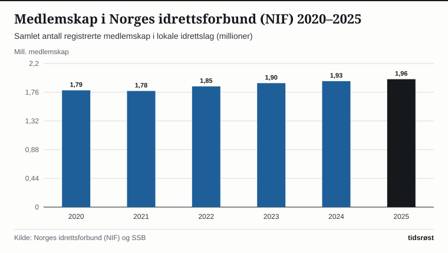

Når snøen legger seg over landet, trer et av verdens mest omfattende frilufts- og idrettsnettverk i funksjon: Hver vinter prepareres mer enn 30 000 kilometer skiløyper i norske skoger, dalfører og fjellområder – en distanse som tilsvarer tre fjerdedeler av jordens omkrets ved ekvator.

Arbeidet utføres i et tett samarbeid mellom kommuner, lokale idrettslag i Norges Skiforbund, løypelag og frivillige foreninger som Skiforeningen. I motsetning til i mange andre land er bruken av hele det norske løypenettet gratis og åpent for alle i kraft av allemannsretten.

## 1,96 millioner medlemskap i 9 500 lokale idrettslag

Parallelt med den uorganiserte skigåingen opplever den organiserte idretten sterk medlemsvekst. Nøkkeltallsrapporten fra Norges idrettsforbund og olympiske og paralympiske komité (NIF) viser at norsk idrett ved utgangen av 2025 samlet 1,96 millioner medlemskap fordelt på rundt 9 500 lokale idrettslag i alle kommuner.

*Samlet antall registrerte medlemskap i Norges idrettsforbund (millioner), 2020–2025. Kilde: NIF og SSB.*

Fotballforbundet, Skiforbundet, Håndballforbundet, Gymnastikk- og Turnforbundet og Friidrettsforbundet er de fem største særforbundene målt i aktivitet, og barne- og ungdomsidretten (6–19 år) har økt i tre år på rad.

## Nasjonalt anleggsregister viser høy anleggsdekning i hele landet

I Kultur- og likestillingsdepartementets nasjonale anleggsregister er det registrert over 60 000 anleggsenheter for idrett og fysisk aktivitet i Norge. Tabellen viser noen av de mest brukte anleggstypene for vinter- og helårsaktivitet:

| Anleggstype | Antall anlegg (ca.) | Typisk finansiering og drift |
|---|---:|---|
| Lysløyper og belyste turløyper | 3 850 | Kommuner og idrettslag med spillemiddeltilskudd |
| Fotballbaner (hvorav over 1 850 kunstgressbaner) | 4 120 | Idrettslag og kommuner; mange med vinterdrift |
| Nærmiljøanlegg (ballbinger, skøyteflater, treningsparker) | 3 640 | Skolegårder, velforeninger og idrettslag |
| Idrettshaller og flerbrukshaller | 1 580 | Kommunale og lagsdrevne haller for helårs innendørsidrett |
| Alpinanlegg, hoppbakker og skiskytteranlegg | 890 | Lokale skiklubber, skiskytterlag og regionale anlegg |

*Kilde: Kultur- og likestillingsdepartementet, Nasjonalt anleggsregister.*

*Utvalgte anleggskategorier i Nasjonalt anleggsregister. Kilde: Kultur- og likestillingsdepartementet.*

## Spillemidler til lysløyper, løypemaskiner og energieffektivt lys

Gjennom den årlige hovedfordelingen av spillemidler fra Norsk Tippings overskudd gir staten direkte tilskudd til bygging og modernisering av skiløyper, skileikområder for barn og utstyr til løypekjøring. De siste årene har mange hundre idrettslag og kommuner fått støtte til å skifte ut eldre armaturer i lysløypene med moderne, strømsparende LED-belysning og smart styring, slik at strømutgiftene reduseres med opptil 60 prosent samtidig som lysforholdene i løypene blir bedre.

Kombinert med digitale karttjenester som *Skisporet.no* og *UT.no*, der innbyggerne i sanntid kan se når løypemaskinen sist kjørte opp sporene i nærområdet sitt, legger infrastrukturen til rette for høy aktivitet gjennom hele vinterhalvåret.

## Kilder

- [Norges idrettsforbund (NIF): Nøkkeltallsrapport for norsk idrett](https://www.idrettsforbundet.no/om-nif/nokkeltall/)
- [Kultur- og likestillingsdepartementet: Nasjonalt register over idrettsanlegg og spillemidler](https://www.anleggsregisteret.no/)
- [SSB: Idrett og friluftsliv – deltakelse i befolkningen](https://www.ssb.no/kultur-og-fritid/idrett-og-friluftsliv/statistikk/idrett-og-friluftsliv-levekarsundersokelsen)
- [Norges Skiforbund: Anlegg, rekruttering og skiglede i hele landet](https://www.skiforbundet.no/fagportal/anlegg/)
