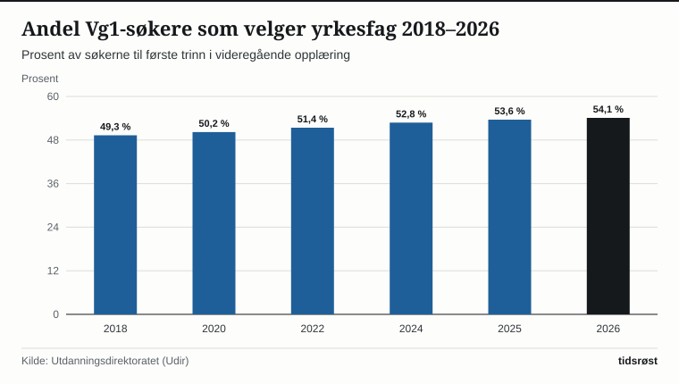

Yrkesfagene står sterkere blant norsk ungdom enn på flere tiår. Ved hovedopptaket til videregående opplæring for skoleåret 2026/2027 hadde 54,1 prosent av søkerne til Vg1 et yrkesfaglig utdanningsprogram som sitt førstevalg, viser søker- og elevstatistikken fra Utdanningsdirektoratet (Udir) og Statistisk sentralbyrå (SSB).

I elleve av landets femten fylker er det nå flere ungdommer som starter på yrkesfag enn på studieforberedende utdanningsprogrammer, med Nordland, Finnmark, Møre og Romsdal, Innlandet og Telemark aller høyest oppe på over 60 prosent yrkesfagandel.

## Teknologi, helse og elektro trekker flest søkere

På Vg1-nivå er *Teknologi- og industrifag* (TIF) og *Helse- og oppvekstfag* (HO) de to klart største yrkesfaglige utdanningsprogrammene, med nær 10 000 elever hver på landsbasis. Tett bak følger *Elektro og datateknologi*, som har hatt sterk vekst i takt med elektrifiseringen av samfunnet og utbyggingen av strømnett og fornybar energi.

*Andel søkere til Vg1 som har yrkesfag som førstevalg, 2018–2026. Kilde: Utdanningsdirektoratet.*

Den norske hovedmodellen for yrkesfag er den såkalte **2+2-modellen**, der elevene først går to år på skole (Vg1 og Vg2) og deretter to år som lønnet lærling i en godkjent lærebedrift før de avlegger fag- eller svenneprøve.

## Nøkkeltall for yrkesfag, lærlinger og fagbrev

Tabellen oppsummerer utviklingen i søkning, lærekontrakter og avlagte fag- og svenneprøver i Norge:

| Indikator | 2021/2022 | 2023/2024 | 2025/2026 |
|---|---:|---:|---:|
| Andel Vg1-søkere til yrkesfag | 50,8 % | 52,0 % | 54,1 % |
| Nye godkjente lærekontrakter | 23 400 | 24 200 | 24 850 |
| Lærlinger i alt (løpende kontrakter) | 46 200 | 47 500 | 48 600 |
| Beståtte fag- og svenneprøver (inkludert praksiskandidater) | 26 900 | 28 100 | 29 400 |

*Kilde: Utdanningsdirektoratet og SSB, tabell 12971 og 12282.*

Mer enn åtte av ti som fullfører læretiden og tar fagbrev, er i fast arbeid allerede få måneder etter avlagt fagprøve – den høyeste overgangen til arbeid i hele utdanningssystemet.

*Antall elever på Vg1 i de fem største yrkesfaglige utdanningsprogrammene i 2026. Kilde: Utdanningsdirektoratet og SSB.*

## Fullføringsreformen og styrket lærlingtilskudd

Med den nye opplæringsloven og regjeringens *Fullføringsreform* har både ungdom og voksne fått betydelig sterkere rettigheter i videregående opplæring. Tidligere var retten til videregående opplæring tidsbegrenset til tre eller fire år; nå har elevene rett til opplæring helt til de har oppnådd studie- eller yrkeskompetanse.

I tillegg gir den nye loven rett til **fagbrev på jobb** og rett til yrkesfaglig rekvalifisering, slik at voksne som allerede har studiekompetanse eller et eldre fagbrev, kan ta et nytt fagbrev som samfunnet og arbeidslivet etterspør. Samtidig har staten økt basistilskuddet til lærebedriftene og stilt krav om bruk av lærlinger ved offentlige bygge- og anleggskontrakter.

## Kilder

- [Utdanningsdirektoratet (Udir): Søkertall til videregående opplæring og læreplassstatistikk](https://www.udir.no/tall-og-forskning/statistikk/statistikk-videregaende-skole/)
- [SSB: Videregående opplæring og annen videregående utdanning](https://www.ssb.no/utdanning/videregaende-utdanning/statistikk/videregaende-opplaering-og-annen-videregaende-utdanning)
- [SSB Statistikkbanken: Tabell 12971 – Elever, lærlinger og lærekandidater i videregående opplæring](https://www.ssb.no/statbank/table/12971)
- [Kunnskapsdepartementet: Ny opplæringslov og satsing på yrkesfag og læreplasser](https://www.regjeringen.no/no/tema/utdanning/grunnopplaring/innsiktsartikler/ny-opplaringslov/id2966828/)
